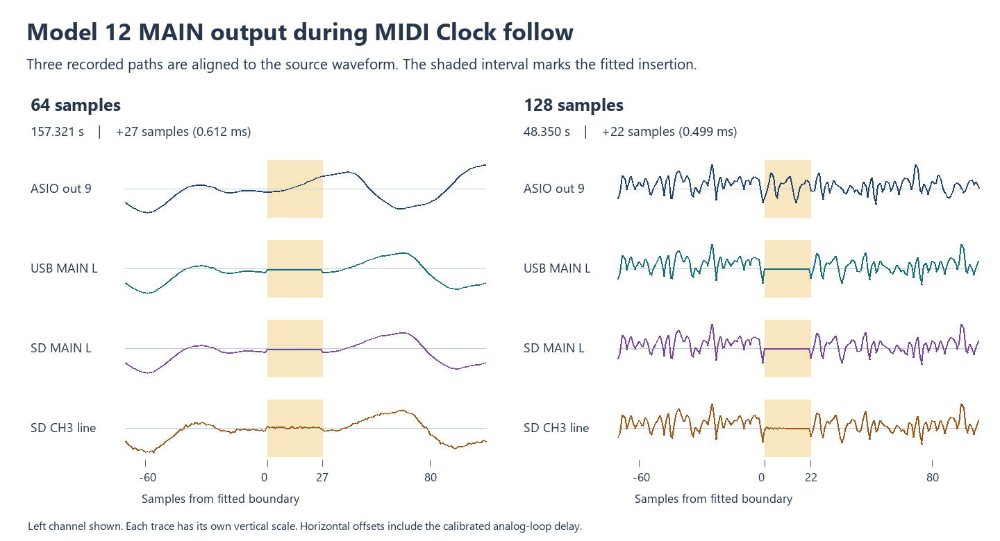

# #1669 本機驗收：Model 12 實體 MAIN 與 USB 同步回錄

**64 與 128 取樣各完成九分鐘實測。** 原第 13.498 秒的 40 取樣缺口在兩輪的相同樂音都未重現。其他時間出現三段較短的近靜音，USB MAIN、SD 內部 MAIN 與實體 MAIN 回接都有錄到，SoundCraft 寫入 ASIO 9/10 的 PCM 在三處都持續變化。波形足以確認實體輸出受到影響；64 取樣最長事件的片段被聽出喀聲，128 取樣的一對片段聽不出差異；驅動交付與 Model 12 內部的責任仍待區分。

## 比對基準

上輪在 44.1 kHz、64 取樣時，從第一個 MIDI Clock 算起約 13.498 秒，USB 回錄多出 40 個取樣（0.907 ms）。接點對到數位輸出區塊 #37504 開頭，下一塊 #37505 超時。ASIO 9/10 的相鄰輸出時間戳相隔 3.581 ms，USB OUT 提交最長相隔 2.020 ms；USB IN 最長為 1.045 ms。雙向都沒有封包錯誤。128 取樣在同一段樂音前後連續。舊錄音缺少實體 MAIN 的獨立副本，無法判定近靜音在哪一段產生。

上輪 64 取樣的前約 50 秒有 Chrome 遠端桌面連線，涵蓋這次插入與 8 次超時中的 5 次。128 取樣全程沒有遠端連線。本輪把遠端狀態固定。原始資料位於本機工作區的 `compatibility-audit/g11-hardware/chorus-direct-asio-buffers/smu-prewarm/soak/`，其中 `etw-gap/REPORT.zh-TW.md` 與 `etw-gap/splice-usb/results.json` 保留舊事件的波形與計時證據。

## 現場清單

### 1. 接線與避免迴授

- [ ] 本體與 SoundCraft 停止播放／錄音。記下原本 MAIN 推桿與喇叭連線，關閉主動喇叭或後級，將 MAIN 推桿拉到底。CH1 麥克風、CH2 的 PC1X 保留原接線。
- [ ] 已確認 CH3、CH4 空著。**先**讓這兩軌的 MAIN 和 SUB 指派鍵彈起，AUX 1、AUX 2/FX 轉到最小，通道推桿到底。選 LIVE，INST 關閉，GAIN 從最低開始。SoundCraft 的輸入監聽也要關閉，避免軟體把回接訊號送回 9/10。
- [ ] 沿用兩條喇叭線，XLR 母頭留在 MAIN OUTPUT。把原接左喇叭的 6.35 mm TRS 插入 CH3 LINE，右喇叭的插入 CH4 LINE。CH9/10 維持 PC 並送 MAIN。此時喇叭已斷開，以錄音電平校準。

### 2. 準備同時錄下的訊號

| 訊號 | 錄在哪裡 | 用來回答 |
|---|---|---|
| SoundCraft 寫入 ASIO 9/10 的立體聲 PCM | 電腦端輸出擷取 | 伴奏交給驅動前，波形是否已改變 |
| MAIN USB 11/12 | 電腦端 ASIO 輸入擷取 | 原先的 USB 回錄現象是否重現 |
| 實體 MAIN L/R → CH3/4 LINE | Model 12 本機 SD 的第 3、4 軌 | 經過類比輸出、線材與輸入 ADC 的訊號是否也有同一缺口 |
| Model 12 內部 MAIN 混音 | 同一首 SD 歌曲的 MAIN 立體聲軌 | 補看缺口是否已出現在內部混音 |

- [x] 本體使用錄音機模式，以空白 **44.1 kHz／24-bit** SD 測試歌曲錄 CH3、CH4，錄音點設 PRE COMP，保留內部 MAIN 軌。兩輪用不同歌曲或不同檔案保留原始 take。實體回接要錄到 SD，才能在電腦 USB 回錄之外保有證據。[原廠方塊圖](https://www.tascam.eu/en/docs/Model12_SettingsPanel-V2_block-diagram.pdf) · [Model 12 錄音與提示訊息手冊](https://cf.tascam.com/wp-content/uploads/downloads/products/tascam/model_12/model-12_om_efs_vh3.pdf)
- [x] 沿用 *Back to the Chorus* 八小節伴奏的長播專案、預熱版 S‑MU2000、120 BPM、4/4、原廠 Model Mixer ASIO 與 9/10 路由。比對專案 SHA‑256 `48e3e022719564695c1c44419d99224b34afb047bd36cc791ee8cc96957eb417`，診斷執行檔 `74f10eb6d56230847c3aaaab57aa92f7c88391e09e33d27ac767b45081d2e3de`。
- [x] 保留電腦經 Model 12 USB MIDI → 本體 DIN OUT → UM‑ONE MIDI IN → SoundCraft 的實體時脈迴路。本體自己的 MIDI CLOCK/SPP 和 MIDI TIMECODE 設為 OFF，避免本機 SD 錄音另送一份時脈。
- [x] 本體歌曲與實際開啟的 ASIO 串流都要是 **44.1 kHz**。若開啟時顯示 `USB Fs mismatch`，核對兩端、消除提示再錄；若在 take 中出現，記下本體時間，保留該段，恢復一致後另錄一輪作對照。每輪都登記 Chrome 遠端桌面狀態，優先兩輪正式錄音全程斷線。

### 3. 短錄校準

- [ ] 開啟 SD 與電腦擷取，先錄底噪，再依序送低電平的左、右識別音及一小段伴奏。將 MAIN 推桿逐步恢復至原本參考位置，調整 CH3/4 輸入增益；兩輪之間維持同一設定。
- [x] **通過條件**：回放或檢視 SD 錄音可辨認左→CH3、右→CH4，電腦也收到對應的 9/10 與 11/12，內部 MAIN 有錄到。記錄兩聲道的底噪 RMS、伴奏峰值與校準電平，確認無削波、無迴授。任一路缺聲道或無法對齊，先修正接線／設定，保留短錄作對照。

### 4. 各錄九分鐘

- [x] **64 取樣**：在 TASCAM 面板設為 64，重新開啟 SoundCraft 串流，分別從 ASIO 輸入、輸出擷取的檔頭及回呼尺寸核對確為 64。先開 SD 錄音、再從 8.000 秒（SPP 64）送 Continue 與九分鐘 Clock，送 Stop 後兩路均保留尾音，再停止 SD 錄音。
- [x] **128 取樣對照**：用同一套線材、歌曲素材、增益、遠端狀態與操作順序重錄，核對輸入、輸出實收均為 128。另存兩輪的 SD 音軌、ASIO 輸入與輸出、回呼計時與 MIDI 紀錄，記下檔名、緩衝、時間及面板提示。
- [x] **資料完整性**：每輪核對 120 BPM、9 分鐘共 25,920 個 Clock，以及 SPP、Continue、Stop 的順序。按原伴奏檢查 34 次預期銅鈸起音，包含 8.000 秒起播的第一下。檢查 SD 起訖涵蓋整輪、音訊區塊序號連續、PCM 未削波；缺失區段標為無法判讀。8.125 秒不補播已有先前短播驗收，本次九分鐘 take 由 8.000 秒開始。

### 5. 波形、判讀與盲聽

- [x] 以第一個 Clock 標示經過時間，用數個共同樂音對齊各路，計入固定延遲、增益、底噪與可能的緩慢漂移。比較同一個樂音在接點前後的取樣位移；分析時保留接點，不用局部拉伸把差異消掉。
- [x] 掃描整輪並單獨檢查原第 13.498 秒附近的樂句、超時回呼與其他位移突變。逐個候選記錄時間、聲道、插入長度（取樣及 ms）、兩側對齊殘差、回呼耗時／超時次數、可用的交付間隔。0.907 ms 短於 64 取樣視窗，不能只靠該視窗的音量門檻。
- [x] **辨識能力通過條件**：在錄音副本上，以鄰近的實測底噪合成已知位置的 40 取樣插入，確認分析能在這個音量找回位置與長度；相同的未插入對照片段不應報出同一事件。無法分辨時，該路標為「靈敏度不足」。
- [x] **依證據填結論**：兩路同一樂音都有相符的插入，表示實體 MAIN 也受影響，再查 SD 內部 MAIN。只有 USB 有，而實體回接與內部 MAIN 都可判讀且連續，才支持 USB 回錄側。只有實體回接有，檢查類比路徑及 SD 軌。兩輪都沒找到，記「本輪未重現」；任一路證據不足，記「無法歸因」。超時或波形異常仍可構成有效的實測結果。
- [x] 回家後對 64 與 128 的 A/B 音檔做音量匹配盲聽，先記 A／B 是否有喀聲、短暫掉音、聽不出差異或不確定，再揭露條件；可聽性與波形判定各自記錄。
- [ ] 停止兩端錄音並保存證據。喇叭仍關閉時拉低 MAIN、拆回接、依 L/R 接回喇叭，還原通道路由、增益、MAIN 與原廠面板原值 256 取樣，再恢復監聽。

## 實測結果

### 256 取樣短錄校準（第一段）

本體已建立 44.1 kHz／24-bit 測試歌曲，回報 MAIN L→CH3、R→CH4 接妥，SD 錄音計數有前進。電腦另用原廠 ASIO 在同一回呼同步擷取 CH3、CH4、MAIN USB 11、12。輸出至 9/10 的 16 秒素材包含底噪段、左與右單邊 440 Hz 識別音及六秒同份伴奏。回呼實收 256 取樣，全段無回呼錯誤旗標，四個輸入均無削波。以下為電腦擷取的回接通道與 USB MAIN 電平，SD 原檔的對應區段與本表相符（四捨五入相差最多 0.05 dB）。

| 電平（dBFS） | CH3 | CH4 | MAIN USB L | MAIN USB R |
|---|---:|---:|---:|---:|
| 底噪 RMS | −104.07 | −103.83 | −84.73 | −84.73 |
| 左單音 RMS | −54.06 | −103.68 | −36.97 | −84.75 |
| 右單音 RMS | −103.89 | −54.13 | −86.82 | −36.97 |
| 伴奏峰值 | −44.91 | −45.09 | −27.98 | −27.98 |

左右單音各到預期通道，另一側接近其底噪。伴奏峰值在實體回接約比 USB MAIN 低 17 dB。SD 歌曲 040208_0001 的 TR03、TR04、TR11、TR12 已複製並以 SHA-256 核對。四軌均為 44.1 kHz、24-bit、1,908,864 個取樣。以兩段伴奏分別對齊各自的 USB 通道，SD 檔案起點差都是 721,319 個取樣，各軌相關係數均高於 0.99999999，全檔無削波。類比回接相對 USB MAIN 的局部延遲約 38 個取樣。以這次短錄中前後 64 取樣 RMS 均為 4–10 個 16-bit PCM 單位的 26 個候選位置驗證，在兩組 SD 立體聲軌的副本插入 40 個實測底噪取樣後，26／26 均量到前後對齊差 40；原副本 26／26 均為 0。這是分析靈敏度對照，正式 64／128 重現結果待測。本機資料在前述 soak 目錄下的 `physical-main-calibration/cal-20261121-170029/`，含 `levels.json`、四聲道 PCM、SD WAV 複本、`sd-check.json` 及 `sensitivity.json`。

### 64 取樣長錄前的取樣率提示

本體操作員在 44/24 測試歌曲確認螢幕顯示 `USB Fs mismatch`。第一次準備錄製時，SoundCraft 的 ASIO 為 44.1 kHz，輸入與輸出均實收 64 取樣。電腦尚未送出起播指令，該次不列入九分鐘測試。Windows 的 Model 12 播放與錄音端點當時均為雙聲道、24-bit、48 kHz。保存原格式後，將兩個端點改為雙聲道、24-bit、44.1 kHz 並讀回確認；重開 SoundCraft 後，ASIO 輸入與輸出再次實收 64 取樣。提示的成因與本體恢復情形仍待現場確認。測試收尾時一併還原這兩個 Windows 端點的原格式。

操作員隨後回報，按 ENTER 後提示已消失，但本體仍無法開始錄音。此時電腦尚未送出九分鐘伴奏，SD 錄音狀態及阻擋原因待核對。

歌曲清單照片顯示本次歌曲為 `040208_0002`。回到歌曲主畫面後，操作員確認 SD 開始錄音。此次嘗試（`sdmain64-song-1795252769967`）在電腦送出 SPP 64 後、送出 Continue 前，即發現 SoundCraft 已在播放，起播檢查因此中止。測試程式退出後，單獨監看 UM-ONE 三秒收到 144 個 MIDI Clock（0xF8），約 120 BPM。這輪未送出預定的九分鐘 Clock，不計入 64 取樣測試；待核對本體 MIDI CLOCK/SPP 設定和錄音時的實際 MIDI 流量，再重新起播。

操作員確認上一段錄音時 Model 12 的 MIDI CLOCK/SPP 為 ON，停錄後已改為 OFF，MIDI TIMECODE 亦為 OFF。64 取樣重測已重新開啟相同專案，在 44.1 kHz 串流中讀回 ASIO 輸入、輸出區塊各為 64 取樣。此次於 SD 開錄後、電腦送 SPP 之前加入三秒 UM-ONE 監看，實際收到的訊息與 SoundCraft 走帶狀態存入該次擷取的 `pre-clock.json`。

### 64 取樣正式長錄（電腦端）

本體操作員確認 SD 錄音計數前進後，UM-ONE 在三秒監看內收到 0 個 Clock、SPP、Continue 或 Stop，SoundCraft 保持停止。電腦送 SPP 64 後，SoundCraft 停在 384,000 個專案取樣（48 kHz，8.000 秒）；隨後送 Continue。2026-11-21 臺北時間 17:29:01.926 收到第一個 Clock，17:38:01.906 收到 Stop。實體 MIDI 迴路收到 25,920 個 Clock、一個 SPP、一個 Continue 和一個 Stop，18 次播放中取樣均在前進，Stop 後走帶停止。Windows Application 的 chromoting 連線紀錄在這段期間沒有新的連線或斷線事件，上一筆是當日 09:38 的斷線。

ASIO 輸入及輸出各擷取 372,091 個區塊，均為 64 取樣，序號無缺口。372,091 個播放回呼中有 2 個超過每塊 1.451 ms 的時限，分別耗時 1.8131 ms 與 1.7309 ms。單憑計時不能判定這兩處的聲音是否中斷。原始紀錄在 `sdmain64-clockoff-1795253190871/` 的 `pre-clock.json`、`record.json`、`timing-summary.json` 及兩路 PCM。兩輪的 SD 波形比對見下表。

操作員確認整輪未見警告，停錄後由 USB STORAGE 讀回 `040208_0002` 的 TR03、TR04、TR11、TR12。四檔的 SD 與電腦複本 SHA-256 逐檔相同，均為單聲道 44.1 kHz／24-bit、33,292,800 個取樣，含正式起播前的錄音。四軌均無削波。ASIO 9/10 與 USB MAIN 分別辨認出 34 次銅鈸起音。

在 13.498 秒前後，左右聲道各四個 1,024 取樣視窗的數位輸出與 USB MAIN 對齊差均為 344 取樣（兩路各自以第一個時脈附近的回呼為基準），相關係數均大於 0.9998。SD 內部 MAIN 與 USB MAIN 在目標前後的檔案座標差維持 8,577,315 個取樣；SD 實體回接相對 SD 內部 MAIN 維持 38 個取樣。此次在原位置未見前一輪的 40 取樣插入。整輪另有五處數位輸出與 USB 回錄的區段對齊差改變，各處的 SD 比對結果列於下表。本段證據為 `sd-040208_0002/manifest.json`、`sd-landmarks.json`、`target-output-usb.json` 及 soak 目錄的 `audio-sdmain64-clockoff-1795253190871.json`。

### 兩輪正式錄音比較

兩輪重開串流後分別核對雙向區塊大小，沿用同一專案、外掛、實體 MIDI 線路與面板增益。128 取樣從第一個 Clock 到 Stop 為臺北時間 17:45:45.322 至 17:54:45.301。兩輪各有 18 次走帶位置抽查，結束均已停播。Windows 的 chromoting 事件紀錄顯示兩輪均無遠端工作階段。本體操作員確認兩輪全程未見警告。

| 實測項目 | 64 取樣 | 128 取樣 |
|---|---|---|
| 電腦擷取目錄 | `sdmain64-clockoff-1795253190871` | `sdmain128-clockoff-1795254265197` |
| SD 歌曲與四個單聲道 WAV 長度 | 040208_0002，各 33,292,800 取樣 | 040208_0003，各 26,229,888 取樣 |
| SD 格式、四軌複本與原卡 SHA-256 | 44.1 kHz／24-bit，全部吻合 | 44.1 kHz／24-bit，全部吻合 |
| ASIO 輸入／輸出區塊 | 各 372,091 塊，均為 64，序號連續 | 各 186,045 塊，均為 128，序號連續 |
| MIDI Clock／銅鈸起音 | 25,920／ASIO 與 USB MAIN 各 34 次 | 25,920／ASIO 與 USB MAIN 各 34 次 |
| 回呼時限／超時次數／最長回呼 | 1.451 ms／2 次／1.8131 ms | 2.902 ms／2 次／3.6704 ms |
| 量到的最長回呼外空檔 | 2.1661 ms | 3.1006 ms |
| SD 削波／40 取樣偵測對照 | 四軌無削波；原樂句四軌各恢復陽性 +40、陰性 0 | 四軌無削波；原樂句四軌各恢復陽性 +40、陰性 0 |
| 第 13.498 秒舊事件 | 相同樂音前後對齊不變 | 相同樂音前後對齊不變 |
| 其他時間，三路 MAIN 均多出近靜音 | 152.290 秒 +14 取樣（0.317 ms）；157.321 秒 +27 取樣（0.612 ms） | 48.350 秒 +22 取樣（0.499 ms） |
| 僅 USB MAIN 前後對齊差縮短，SD 兩路保持連續 | 68.854 秒 −5、121.024 秒 −6、421.207 秒 −6 取樣 | 103.544、227.850、491.622 秒各 −5 取樣 |

**波形核對方法。** 用舊錄音發生插入時的 ASIO 波形，在每輪數位輸出找同一樂音，分別以接點前、接點後及跨接點三段獨立定位。每輪的三個定位都落在同一個取樣，相關係數均大於 0.9998。兩輪在該處的 SD 實體回接相對內部 MAIN 前後均為 38 取樣，USB 與數位輸出也沒有位移突變。另在每輪四個 SD 音軌的副本加入 40 個實測背景取樣，同一組前後視窗均可找回 +40；未插入副本則量到 0。

**三處新事件。** 以分段對齊找出其他位移變化，再在各變化兩側分別比對四條路徑的左右聲道。在上表三個正向位移，ASIO 來源持續有訊號，三路 MAIN 同時多出低電平區段。以 128 取樣的左聲道為例，實體回接在接點前 64 取樣、中央 22 取樣、接點後 64 取樣的 RMS 分別為 10.78、0.69、8.73（16-bit 等效 PCM 單位）。其餘六個負向位移的實體回接與 SD 內部 MAIN 相對來源都保持連續。128 取樣整秒比對標出的三個音量下降候選，改用局部 −22 取樣對齊後皆能匹配原音。這三個候選對應同一次位移。

**歸因限制。** 64 取樣的 +27 接點附近出現 1.7309 ms 的超時回呼，但 +14 和 128 取樣的 +22 接點前後 20 ms 內，最長回呼各為 1.4242 和 2.7925 ms，均在該輪時限內。這三處附近相鄰 ASIO 輸出時間戳的最大間距分別為 3.655、3.091、5.532 ms（依 +27、+14、+22 順序）。這批擷取能把異常定位到 SoundCraft 輸出 PCM 之後，尚無法在驅動、USB 輸出或 Model 12 內部之間指定根因。舊的 40 取樣事件當時欠缺 SD 同錄，不能回溯判定其來源。本次未改產品程式。8.125 秒不補播沿用先前短播結果，本次兩輪皆從 8.000 秒起播。

**證據與盲聽。** 本機兩個擷取目錄分別保存錄音清單與雜湊、`record.json`、`timing-summary.json`、`four-paths.json`、`transition-fit.json`、`transition-sd-rms.json`、`overrun-flanks.json` 及 `transition-timing.json`。每輪另有一個音量匹配的實體 MAIN 立體聲 A/B 檔（`listen-main-64-AB.wav`、`listen-main-128-AB.wav`），取該輪最長插入及同輪另一遍相同樂句。兩側參考波形與對照的相關係數均高於 0.99。每段 1.6 秒，接點在各段約 0.75 秒，兩段相隔 0.85 秒。聽感與揭盲結果見下節。

**設備收尾。** SD 已由 Windows 安全退出，操作者確認兩支喇叭依原 L/R 接回、喇叭關閉、MAIN 在底。原廠面板已還原為 256 取樣，Windows 兩個 Model 12 端點已自備份還原，逐一讀回均為雙聲道 24-bit／48 kHz。本體 MIDI CLOCK/SPP 與 MIDI TIMECODE 本輪設為 OFF。

### 盲聽結果（2026-11-21）

兩輪皆先記錄操作者聽感，再讀取各輪預存的 `blind-key.json`。兩個播放檔的 A 段均來自同一輪另一遍相同樂句，B 段均來自實測近靜音事件。用 SD 的 CH3 原檔重建播放檔左聲道並比對，排除首尾淡化區間後，對應片段的最大誤差為 1 個 16-bit PCM 單位。

| ASIO 緩衝 | 揭盲前的原話 | B 段的實測事件 | 判讀 |
|---|---|---|---|
| 64 取樣 | 「B的播放中有喀聲」 | 157.321 秒，27 取樣（0.612 ms） | 回報有喀聲的片段與事件片段吻合。 |
| 128 取樣 | 「聽不出差異」 | 48.350 秒，22 取樣（0.499 ms） | 這次播放條件下，操作者無法從聽感分辨這一對片段。 |

每個緩衝只比較一對片段，重播沿用同一順序。64 取樣的另一個 14 取樣事件未納入盲聽。這次聽感只適用於受測片段與聆聽條件，根因仍待釐清。

## 實測後待辦

以下五項等上述實機測試完成、結果與限制寫入本報告後才開始。

- [x] **錄音決定。** 在 #1669 允許 Beat Clock 跟隨時錄音（音訊與 MIDI）。PR 說明寫清楚：Clock 跟隨時拍子網格隨外部時脈走，錄音自然對齊；#1663 的 MTC Online 在定位後以本機時脈運行，錄音中重新定位會造成錯位，因此禁止錄音。Clock 中斷時沿用使用者的「中斷時」選項：選繼續播（Coast）就繼續錄，選停止（Stop on loss）就同時停止 transport 與錄音。補音訊與 MIDI 在這兩種策略下的回歸測試，並驗證 MTC Online 的既有限制。
  - 程式與自動回歸測試見 [#1669 的錄音修正 `ed7ae31`](https://github.com/storytold/soundcraft/pull/1669/commits/ed7ae3179a67d67d225b0e7b87da668b426a872d)。以模擬輸入在 120 BPM 專案跟隨 100 BPM 時脈，同時錄一軌音訊和一軌 MIDI，實際解碼寫出的 WAV，並讀回 MIDI clip。
  - **Coast**：故意讓 Continue 後的脈衝晚一個 MIDI Clock 脈衝（25 ms）。舊版從第 24,000 個取樣跳到第 25,200 個；修正後留在 24,000。整輪寫入 25,200 個取樣，三段 PCM 的振幅與順序正確，三個音符落在第 0、400、800 tick。收到明確的 MIDI Stop 後結束錄音。
  - **Stop on loss**：停止送脈衝後，接收端逾時即結束播放與兩軌錄音。WAV 保留逾時前的 12,000 個取樣，MIDI clip 只含第一個音。MTC Online 禁止錄音的既有回歸也通過。本項驗證使用模擬音訊和 MIDI 輸入。上方的 Model 12 實機段落記錄的是既有播放與回錄驗收。
- [x] **精簡 #1669 說明。** 把監聽預填、ASIO 緩衝比較、波形偵測方法與完整數據整理到 `docs/` 的硬體報告，PR 說明只留摘要與連結。
  - [公開硬體驗收報告](https://github.com/mtlcl410/soundcraft/blob/0d549b50030f486971b35082ae2876515129be18/docs/model-12-clock-follow-hardware.md) 已收錄監聽預填、直接 ASIO、緩衝對照、波形偵測和八張比較圖。已用未登入的連線從 GitHub 讀回報告與全部圖檔，核對圖檔內容。
- [x] **256 取樣的已知限制。** 在 Known limits 如實寫明先前 12 次中有 1 次波形偏差、原因未明，並開 issue 附上量測條件、偵測方式與證據追查。與本次 64 取樣的 40 取樣插入分別記錄。
  - 重算 12 組原始 WAV，只有重開串流後的第一個 8.000 秒起播（`repeat2-256/exact-a`）超標，右聲道殘差跳幅 455.46，其餘 11 次為 2.06–2.54（16-bit PCM 計數，門檻 16）。12 次均未觸發低電平判定。已在 [#1669 的 Known limits](https://github.com/storytold/soundcraft/pull/1669) 與 [追查 issue #1686（含對照圖）](https://github.com/storytold/soundcraft/issues/1686) 雙向連結；64 取樣第 13.498 秒的 +40 取樣另列為不同事件。
- [ ] **#1674 的修正歸屬。** 在 main 與 Clock 跟隨分支以相同重現步驟比對；若 main 原已存在，將修正拆成獨立 PR。若只在 Clock 跟隨出現，再依證據處理 #1669。
- [ ] **Ready 前複審。** 最終修改推到 #1669 之後、轉為 Ready for review 之前，手動觸發一次 CodeRabbit review，核對審查對應的 commit 並處理結果。
