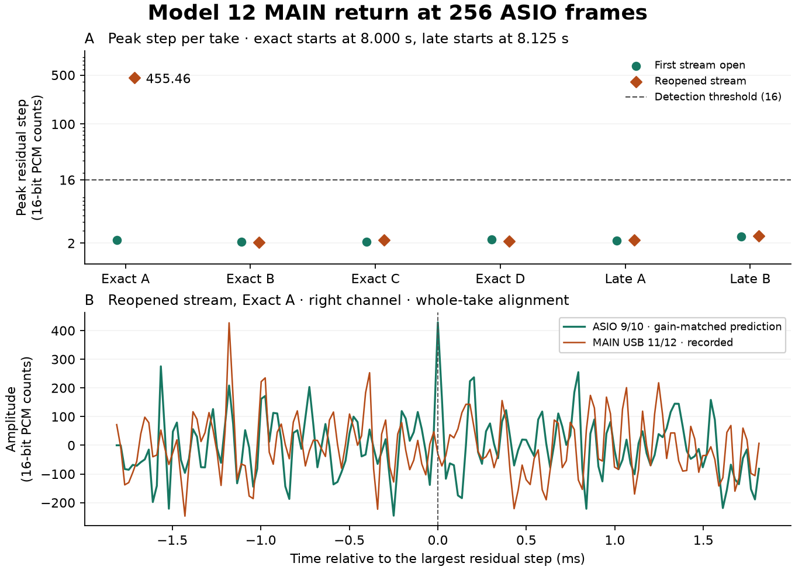
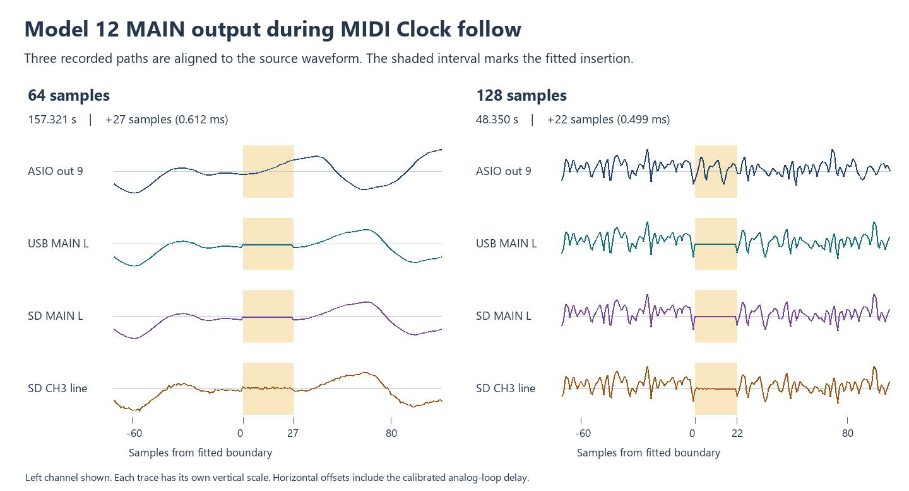

## G-11 verification evidence

The two follow reports below preserve the hardware measurements, the signal paths, and the software-rendered PCM results. Positive timing errors mean late arrivals. The eleven figures are embedded at an immutable revision. Each report identifies its test conditions. The expandable records at the end also cover Beat Clock output and MTC generation/chase. No measurements were repeated for this documentation update.

## External MIDI Beat Clock follow on the TASCAM Model 12

SoundCraft played the chorus crash once when the external sequencer resumed on its onset at 8.000 s. Resuming one sixteenth later at 8.125 s skipped the crash and played the following accompaniment. With the same project and a 256-frame buffer, sending audio directly to ASIO 9/10 reduced the mean time from the first MIDI Clock to the recorded MAIN return from 62.49 to 28.07 ms on this setup.

## Signal paths and controls

- **Transport.** The Model 12 recorder drove SoundCraft through its DIN OUT and a Roland UM-ONE. Model 12 USB MIDI and the independent UM-ONE capture each saw 842 clocks, Start, Continue and two Stops. After a backward Song Position Pointer (SPP) from 88 to 41, SoundCraft resumed and stopped. Both passes measured 120.00 BPM on the wire.
- **Tempo and loss.** For repeatable tempo changes, the computer sent MIDI through Model 12 USB MIDI → hardware DIN OUT → UM-ONE → SoundCraft. At zero input calibration, the script switched from 120 to 100 BPM, interrupted Clock for 1.1 s and located backwards to SPP 12 (sample 72,000 at 48 kHz). Coast kept playback rolling and Stop on loss stopped it. Each policy passed all eight transport checks on Windows integration build `0a8f553`. The later audio/MIDI **recording** regressions on `ed7ae31` used simulated input.
- **Audio.** The timing runs used the same eight-bar S-MU2000 accompaniment at 120 BPM in 4/4. Each short run sent SPP, Continue, 144 clocks and Stop. For the bridged route, a 48 kHz Windows digital loopback fed a monitor process that sent audio to Model Mixer ASIO 9/10 at 44.1 kHz. For the direct route, SoundCraft opened 9/10 itself. “MAIN USB” below means the stereo mix returned on USB 11/12. The nine-minute runs also captured the physical MAIN line outputs on the SD recorder. Loudspeaker latency was outside these measurements.

## Resume on the chorus boundary

At 120 BPM each SPP unit lasts 125 ms. We counted crash attacks against a from-head reference, including the tail after Stop, and checked that the later accompaniment still matched. The original Windows integration missed the exact-position crash. Preserving the requested musical origin separately from the latency-compensated render cursor restored it.

| Start position | Initial physical-loop results on digital output and MAIN USB |
| --- | --- |
| SPP 60 · 7.500 s | One crash after the lead-in (one take). |
| SPP 64 · 8.000 s | Exactly one crash as the first audible attack (two takes). |
| SPP 65 · 8.125 s | Zero crashes (two takes). Later accompaniment correlation exceeded 0.997. |


## Eight-bar accompaniment at 120 and 100 BPM

At 48 kHz, the same S-MU2000 project contains five tick-based MIDI clips spanning 32 quarter notes. The Model 12 started each take from the top and supplied Beat Clock over DIN through the UM-ONE. We counted snare onsets independently in the digital accompaniment and the Model 12 MAIN USB return (11/12), matching against the project’s snare sample. The PC1X was idle during the accompaniment.

| Model 12 tempo | Before, digital / MAIN snares | After, digital / MAIN snares | Measured beat on MAIN | Final hi-hat after chorus crash on MAIN | Eight-bar clip end on the grid |
|---|---|---|---|---|---|
| 120 BPM | 8 / 8 | 8 / 8 | 499.86 ms | 7.748 s | 16.000 s |
| 100 BPM | 5 / 5 | 8 / 8 | 600.23 ms | 9.303 s | 19.200 s |

Both corrected takes had one chorus crash on each path and followed Stop. At 100 BPM the final three snares belong at 16.2, 17.4 and 18.6 s, beyond the original 16 s clip boundary. An initial corrected 100 BPM take captured digital audio only. The repeated take supplied both paths in the table. A separate physical MIDI loop replay of the captured 883 and 904 clock pulses at 100 and 120 BPM, respectively, also produced all eight snares in each digital recording.

The external-clock regression renders the eight notes on a temporary playback grid and checks the saved clip still ends on its original grid. Ordinary session tempo edits reproduce the same audible loss on upstream main without MIDI hardware. The main-targeted work is tracked separately in [PR #785](https://github.com/storytold/soundcraft/pull/785) and [issue #1690](https://github.com/storytold/soundcraft/issues/1690).

## Changing tempo at the chorus

Two SoundCraft instances played eight bars in 4/4. The leader sent Beat Clock through Model 12 USB MIDI → DIN OUT → Roland UM-ONE and changed tempo at bar 5. We captured both instruments on separate channels of one 48 kHz Windows digital loopback. The full performance contained all 32 drum beats and 64 S-MU2000 bass attacks in both directions. Starting at the chorus produced 16 beats and 32 bass attacks in each direction.

For timing, we substituted a short hi-hat for the bass and matched each channel against its own percussion sample (normalized correlation above 0.85). The table gives follower minus leader on bar 5 beat 2, relative to the median offset on song beats 5–14. Negative values mean the follower played early.

| Tempo step | Before, one take per direction | After, three takes per direction |
| --- | ---: | --- |
| 120 → 100 BPM | −98.68 ms | −28.48, −41.79, −34.46 ms |
| 100 → 120 BPM | +59.09 ms | +24.54, +26.78, +33.15 ms |

All six post-fix takes contained the expected attacks. Across the six takes, the final four beats' median offset was within 4.05 ms of the verse baseline. The very first attack after Start had a separate 40–50 ms raw offset on this two-instance setup. These captures measure digital output. The physical MAIN measurements below used separate runs.

The deterministic regression drives the actual input and playback grid with a 30 ms render horizon. On the previous head (`5b1418a8`), the next backbeat landed 4,552 samples early at 48 kHz on the slowdown. The revised estimator and grid pass the one-Clock tolerance in both directions and preserve the bar-5 downbeat in this test.


## Three-section dance track at 80, 130 and 80 BPM

The leader played four bars at each tempo, switching at 12.000 and 19.385 s during one continuous performance. The follower project had a single 80 BPM tempo. Clock went through Model 12 DIN OUT and UM-ONE. Both instruments used the same 48 kHz digital loopback capture. Three percussion takes per build placed exactly one kick on each of the 48 beats and one hi-hat on each of the 96 eighth notes. We also played a full arrangement with bass, snare and a crash at each tempo change.

Each value below is the follower onset minus its expected time, relative to the median offset on the seven reference beats preceding the change (beats −8 through −2). Offbeats are measured against the midpoint between adjacent leader kicks. Negative values mean the follower played early.

| Transition and onset | Before (`d1545d2`), three takes | After, three takes |
| --- | --- | --- |
| 80 → 130, first offbeat | +54.5 to +59.6 ms | +21.4 to +29.3 ms |
| 80 → 130, next beat (bar 5 beat 2) | +47.7 to +52.7 ms | +5.4 to +6.2 ms |
| 130 → 80, first offbeat | −133.9 to −122.4 ms | −126.1 to −101.9 ms |
| 130 → 80, next beat (bar 9 beat 2) | −127.7 to −113.1 ms | −37.2 to −25.8 ms |

The first offbeat after the slowdown remains over 100 ms early in these takes. By the last four beats the median offset was within 6.7 ms of the preceding section's baseline.


## From the first Clock to the first mixed block

Four exact starts per build isolated repeated project and instrument preparation on Continue. Probes timestamped MIDI input, host processing, session preparation, command receipt and completion of the first mixed block. Times are in milliseconds.

| Interval | Before snapshot reuse | With snapshot reuse |
| --- | ---: | ---: |
| First Clock to host processing | 14.5–15.0 | 14.7–31.2 |
| Session preparation | 7.404–7.565 | 0.001–0.002 |
| Play command to callback | 2.9–9.6 | 1.0–7.4 |
| Callback to completed first mix | 2.1–2.8 | 2.1–2.8 |
| First Clock to completed first mix | 27.6–34.9 | 18.5–34.6 |
| First mix to digital loopback | 12.4–13.0 | 11.8–14.6 |
| First Clock to digital crash, mean (range) | 43.8 (40.3–47.9) | 37.9 (31.9–47.2) |


The 31.2 ms host wait prompted a second comparison. The original take had no OS scheduling trace. Eight starts on `f5de549` showed that dispatch still waited for a GUI frame. Six exact starts and two late starts per build then compared that path with first-Clock dispatch from a prepared, stopped locate.

| Interval | Host-frame dispatch | Prepared dispatch |
| --- | ---: | ---: |
| First Clock to Play command, eight starts | 14.427–15.367 ms | 0.001–0.002 ms |
| First Clock to digital crash, mean of six exact starts | 35.2 ms | 21.3 ms |
| First Clock to MAIN USB crash, mean of six exact starts | 92.6 ms | 77.6 ms on the final build without probes |

With probes removed, digital onset averaged 19.5 ms (15.3–25.2 ms). The command measurements sampled just before submission on the earlier build and just after return on the fixed build. In each batch, digital and MAIN captured one crash per exact start and zero per late start.


## Monitor prefill and direct ASIO

Six exact starts averaged 19.47 ms to digital loopback and 77.61 ms to MAIN USB. Of the additional 58.14 ms, monitor capture to ASIO callback accounted for 45.13 ms and callback to MAIN return for 14.95 ms. The independent monitor timestamp preceded the digital witness by 1.94 ms. The earlier observation of about 77 ms *between* digital and MAIN had fewer taps, so its exact split is unknown.

After warming the streams, two passes in opposite prefill order gave digital-to-MAIN times of 45.1 / 41.1 ms (20 ms prefill), 59.3 / 60.3 ms (40 ms) and 82.3 / 74.5 ms (60 ms). An exploratory 20 ms run before warm-up took 145.9 ms across the bridge. A separate 256-frame comparison alternated 40 and 20 ms prefill, with four exact and two late starts per setting.

| Mean of four exact starts | 40 ms prefill | 20 ms prefill |
| --- | ---: | ---: |
| Monitor capture to ASIO output callback | 48.59 ms | 30.14 ms |
| ASIO output callback to MAIN USB | 14.50 ms | 14.59 ms |
| Digital loopback to MAIN USB | 61.15 ms | 43.04 ms |
| First Clock to MAIN USB | 83.15 ms | 62.49 ms |

Replaying the recorded crash straight to ASIO 9/10 gave 14.38–15.61 ms from output callback to MAIN USB in six repetitions. The interval includes the driver, device and USB capture. These timestamps cannot assign a one-way delay to each stage.


Direct SoundCraft playback used Clock follow at `2b53c7e` with the Windows sample-format and hardware routing from #1634 and #1635. The driver accepted one ASIO client, so a diagnostic copied duplex input 11/12 to a background writer. Both routes used a 0.90 waveform-match threshold and the same 6.80 ms input-time correction.

| First Clock to MAIN USB, four exact starts | Mean | Range |
| --- | ---: | ---: |
| 20 ms monitor prefill, 256 frames | 62.49 ms | 57.47–65.47 ms |
| Direct ASIO 9/10, 256 frames | 28.07 ms | 24.21–32.03 ms |

The direct route saved 34.42 ms on average across these separate runs. MAIN contained the crash once in all four exact starts and zero times in both late starts. The later accompaniment matched in all six (minimum correlation 0.994).


## Driver buffer size and waveform detection

Requesting 128 or 64 frames while the TASCAM panel was set to 256 still delivered 256-frame input and output callbacks. We changed the panel, reopened the stream twice per setting and measured the actual sizes in both directions. Each row covers eight exact and four late starts at 44.1 kHz. The timing mean uses the eight exact starts.

| Actual input/output frames | First Clock to MAIN USB, mean (range) | Input timestamp correction | Takes with residual steps | Low-level windows |
| --- | ---: | ---: | ---: | ---: |
| 256/256 | 27.20 ms (23.59–32.43) | 6.803 ms | 1/12 | 0 |
| 128/128 | 21.52 ms (18.97–26.59) | 3.900 ms | 2/12 | 1 |
| 64/64 | 15.33 ms (12.87–21.14) | 2.449 ms | 4/12 | 0 |

All 24 exact starts produced one crash each. All 12 late starts had zero crashes and retained the later accompaniment. No clipping or gaps in the callback capture sequence were detected. The cause of the single 256-frame waveform deviation remains open.


**How the detector works.** Align the native ASIO 9/10 output to the simultaneous MAIN USB 11/12 return once per take, fit stereo gain, then look for steps in the residual greater than 16 counts in 16-bit PCM units. The low-level detector flags 64 consecutive samples whose MAIN RMS falls below 20% of the expected RMS when the expected level exceeds 30 counts. Copies of a clean take with a 64-frame mute and a one-sample spike served as positive controls. A timing shift can trigger the residual test even when the signal level is intact.

**256-frame exception.** Reanalysis of all 12 paired WAVs identified the first exact start after reopening the stream (`repeat2-256/exact-a`). The peak sample-to-sample change in the residual was 455.46 counts on the right channel, compared with 2.06–2.54 in the other 11 takes (flag threshold 16). The whole-take alignment placed MAIN 1,326 frames after the ASIO output. No take triggered the low-level detector. The flagged take played the crash once, with continuous input/output callback sequence numbers and no clipped frames in the MAIN capture. Its cause and audibility remain undetermined.



At 128 frames, a 64-sample window (1.45 ms) measured 14.9 counts RMS on MAIN against 98.4 on gain-matched output. It began 4.35 ms into the crash. Independent replays of the original 128-frame output and of three flagged 64-frame takes yielded clean MAIN returns. Two of the four 64-frame flags were cold starts. The other two fit a change in relative alignment of five or six samples, reducing residual steps below 2.4 counts.

On fresh cold starts, the first sounding callback took 10.64 ms at 128 frames (2.90 ms budget), including 10.04 ms inside S-MU2000. At 64 frames it took 7.28 ms (1.45 ms budget), including 6.78 ms inside the plug-in. These elapsed times include scheduling. Both showed a MAIN deviation, but the specific 128-frame RMS drop did not recur. A control copy with the verse-bass VST3 assignment removed retained the four drum instruments, took 0.12 ms for the first 64-frame block and produced six clean returns. With the original project, all 12 exact and six late resumes in this follow-up passed the crash-count checks.


## Physical MAIN and USB return over nine minutes

A subsequent run used the prewarmed S-MU2000 project and captured native ASIO 9/10 output, MAIN USB 11/12, internal MAIN on SD, and physical MAIN L/R looped back to CH3/4 on SD (PRE COMP, both channels unassigned from MAIN and SUB). Level and routing stayed fixed. Each actual buffer size ran for nine minutes from 8.000 s, with a 44.1 kHz/24-bit SD song, 25,920 clocks and 34 crash onsets on both ASIO and MAIN USB. The 8.125 s check above comes from the short runs.

| Observation | 64 frames | 128 frames |
| --- | --- | --- |
| ASIO input/output blocks per direction | 372,091, sequence continuous | 186,045, sequence continuous |
| Callback overruns / longest callback | 2 / 1.8131 ms | 2 / 3.6704 ms |
| Extra near-silent samples on all three MAIN paths | +14 at 152.290 s and +27 at 157.321 s | +22 at 48.350 s |
| Shorter alignment on MAIN USB only | 5–6 samples at three points | 5 samples at three points |
| Blind A/B of the longest insertion versus a matched phrase | Listener reported a click in B, the +27-sample excerpt | Listener could not distinguish the +22-sample excerpt |

The earlier +40-sample event at 13.498 s did not recur at the matching phrase. Independent windows before, after and across that phrase located the same source sample (correlation >0.9998). Adding 40 measured background samples to copies of each SD track recovered +40. Unmodified copies measured zero. At the three new positive shifts the ASIO output continued to carry signal and all three MAIN paths gained a low-level interval. Only the +27 event was near an over-budget callback. The captures locate the change downstream of the output PCM. The individual driver, USB output and device stages remain unresolved.

Each blind comparison used one 1.6 s excerpt per condition from the physical return, level-matched to another pass through the same phrase. Replays kept the same order, and the keys were opened after both responses. This tests those two excerpts only. The short-run 128-frame dropout above and the long-run +22-sample excerpt are different events.




## External MIDI Beat Clock response

These are 48 kHz software-rendering measurements for external MIDI Clock follow. The input is a deterministic sequence of timestamped F8 messages. The measurements use actual sampler attacks, releases and metronome PCM. A positive error means the attack was late relative to the source score. Device buffering is simulated in these tests.

## Abrupt tempo changes

Each case has eight post-change beats of eighth notes. Pulse 384 is a bar line and pulse 396 is halfway through a beat. Each cell gives the signed deviation of the first eighth after the cut (ms), maximum absolute deviation from the second beat onward (ms), and number of received F8s until confirmation. The packed input cycles through groups of three, four and five pulses within 1 ms with gaps between groups. A batch is timestamped at its first pulse.

| Step (BPM) | Cut (F8) | ±1 ms | ±2 ms | 3–5 packed |
| --- | --- | --- | --- | --- |
| 130→80 | 384 | +0.1667 / 3.4792 / 2 | +1.9792 / 4.1875 / 2 | -144.2500 / 0.0000 / 7 |
| 130→80 | 396 | +0.7292 / 2.6042 / 2 | -5.7083 / 2.3958 / 2 | -144.2292 / 0.0000 / 7 |
| 120→100 | 384 | +0.0208 / 0.3125 / 4 | +1.6042 / 1.1250 / 4 | -50.0000 / 0.0000 / 15 |
| 120→100 | 396 | +0.0208 / 3.0208 / 4 | +2.9583 / 2.7708 / 4 | -50.0000 / 0.0000 / 15 |
| 180→60 | 384 | +6.6042 / 4.7500 / 2 | -0.6875 / 4.1667 / 2 | -196.8958 / 196.8958 / 7 |
| 180→60 | 396 | -4.9583 / 2.6042 / 2 | +5.8750 / 1.4583 / 2 | -196.8958 / 196.8958 / 7 |
| 100→120 | 384 | +3.7708 / 2.7292 / 3 | +4.5417 / 1.7500 / 3 | +50.0000 / 0.0000 / 15 |
| 100→120 | 396 | +0.6875 / 0.9583 / 4 | +3.5833 / 2.8333 / 3 | +50.0000 / 0.0000 / 15 |
| 80→130 | 384 | +0.7917 / 0.8958 / 2 | +1.5417 / 2.4167 / 2 | +0.0000 / 0.0208 / 7 |
| 80→130 | 396 | +0.3542 / 2.3958 / 2 | +1.1042 / 1.8750 / 2 | +0.0000 / 0.0208 / 7 |
| 60→180 | 384 | +0.1667 / 0.3750 / 2 | +1.5833 / 1.2292 / 2 | +0.0000 / 0.0000 / 7 |
| 60→180 | 396 | +0.8333 / 0.4583 / 2 | +0.3125 / 0.6667 / 2 | +0.0000 / 0.0000 / 7 |

Across the 36 cases all 1,782 expected notes had a single attack and the complete 96-sample voice. At ±1 and ±2 ms, the two-interval path confirmed 8 of 12 changes in each profile. The four-interval path handled the remaining four at the third or fourth incoming F8 after the cut (an interval can span the cut). Under grouped delivery, two or four independent group intervals took seven or fifteen received F8s. Each changed train produced one confirmation. No confirmation preceded the change. The 10/4 ms ideal-input thresholds remain a separate regression. With timestamp jitter three later peaks exceeded 4 ms. The jitter regression enforces 10 ms on the first eighth and 6 ms thereafter; the ideal-wire regression still enforces 10/4 ms. The most extreme packed slowdown was 196.896 ms early.

Four additional ten-minute, 120 BPM runs used group widths of 3, 4, 5 and cycling 3–5. Each rendered 2,400 intact eighth notes with zero false steps, dropouts or onset error. The prior head produced 194 loss indications and 88 empty/88 overfull eighth-note slots across the twelve variable-burst changes. Shifted onsets can leave a slot empty even when the raw attack count is unchanged.

## Output deadlines

A locked follower may project as far as the end of the audio the device actually requests. A callback shorter than one F8, missing presentation timing, an overdue pulse, a detected rate change or non-uniform packet delivery uses the existing wire limit. A later transition into Coast follows the configured loss policy. The sampler and click continue to render their tails at the device rate.

Each steady range covers individual note and click attacks. Hard uses the last received F8 plus one pulse. Selected allows bounded prediction. For the slowdown, the source rate drops by 20% (200→160, 240→192, 300→240). Each row sweeps all 24 pulse positions in the beat and four callback alignments. Offbeat is the first subsequent offbeat and Beat is the next quarter-note boundary strictly after the cut. Values are worst signed errors by magnitude in ms across the 96 alignments. If the change lands exactly on a quarter-note boundary, the attack on that boundary spans +20.646…+82.875 ms with the hard cap and 0…+57.979 ms with the selected policy. The reference includes presentation lead, so adding driver latency again would double-count it.

| BPM | Frames | Lead (ms) | Steady hard | Steady selected | Offbeat hard | Offbeat selected | Beat hard | Beat selected |
| --- | --- | --- | --- | --- | --- | --- | --- | --- |
| 200 | 128 | 30 | +20.646…+22.646 | +20.646…+22.646 | +19.646 | +19.646 | +19.646 | +19.646 |
| 200 | 128 | 50 | +40.646…+42.646 | +40.646…+42.646 | +39.646 | +39.646 | +39.646 | +39.646 |
| 200 | 512 | 30 | +28.646…+38.646 | +28.646…+38.646 | +35.646 | +35.646 | +35.646 | +35.646 |
| 200 | 512 | 50 | +48.646…+58.646 | +48.646…+58.646 | +55.646 | +55.646 | +55.646 | +55.646 |
| 200 | 2048 | 30 | +28.646…+61.979 | +0.000…+0.000 | +60.542 | +60.542 | +60.458 | +60.458 |
| 200 | 2048 | 50 | +48.646…+81.979 | +0.000…+0.000 | +80.542 | +80.542 | +80.458 | +80.458 |
| 240 | 128 | 30 | +22.312…+24.646 | +22.312…+24.646 | +22.271 | +22.271 | +22.250 | +22.250 |
| 240 | 128 | 50 | +42.312…+44.646 | +42.312…+44.646 | +42.271 | +42.271 | +42.250 | +42.250 |
| 240 | 512 | 30 | +30.312…+40.062 | +0.000…+0.000 | +37.729 | +37.729 | +38.250 | +38.250 |
| 240 | 512 | 50 | +50.312…+60.062 | +0.000…+0.000 | +57.729 | +57.729 | +58.250 | +58.250 |
| 240 | 2048 | 30 | +30.312…+62.646 | +0.000…+0.000 | +61.667 | +61.667 | +61.812 | +60.771 |
| 240 | 2048 | 50 | +50.312…+82.646 | +0.000…+0.000 | +81.667 | +81.667 | +81.812 | +81.375 |
| 300 | 128 | 30 | +24.646…+25.979 | +24.646…+25.979 | +24.812 | +24.812 | +24.812 | +24.812 |
| 300 | 128 | 50 | +44.646…+45.979 | +44.646…+45.979 | +44.812 | +44.812 | +44.812 | +44.812 |
| 300 | 512 | 30 | +32.646…+36.979 | +0.000…+0.000 | +40.062 | +40.062 | +40.229 | +40.229 |
| 300 | 512 | 50 | +52.646…+56.979 | +0.000…+0.000 | +60.062 | +60.062 | +60.229 | +60.229 |
| 300 | 2048 | 30 | +32.646…+65.104 | +0.000…+0.000 | +63.875 | +63.875 | +64.042 | +63.271 |
| 300 | 2048 | 50 | +52.646…+85.104 | +0.000…+0.000 | +86.500 | +86.500 | +84.042 | +83.771 |

Across both policies the slowdown sweep verified 58,752 attacks and their complete waveforms. An initial projection implementation muted 201 sampler notes and damaged 28 tails on the return from a slowdown. Keeping overdue MIDI events ordered when prediction resumes removed all 229 failures. The selected policy’s first offbeat spanned −25.000 to +86.500 ms, and the next beat −25.000 to +83.771 ms. The −25.000 ms attack was already in the device queue before an old-rate pulse first became overdue. The largest positive error occurred at 300 BPM, 2,048 frames and 50 ms lead after falling back to the wire limit.

Once PCM is committed to the device, a tempo change cannot revise it. An early attack in the device queue and a late attack held by the strict wire limit have different causes. The measured maxima describe these settings and phases. Other drivers, block alignment and clock sources can give different results.

## Continuous tempo and stability

The 124 BPM round trip took 32 bars out and 32 bars back for each ±8% excursion. First-pulse estimation was excluded from the BPM display statistic. The regression requires the transport to be locked and one beat of estimates to have arrived. The linear period/phase fit continues to reject jitter. When the long fit detects sustained curvature above the residual noise floor, the writable tempo grid makes smaller, more frequent corrections.

| Source excursion | Clean | ±1 ms | ±2 ms |
| --- | ---: | ---: | ---: |
| +8% and return | 2.3542 | 2.4375 | 3.8333 |
| −8% and return | 2.7708 | 2.9167 | 3.7500 |
| 124.0→124.3→124.0 BPM | 3.1042 | 3.0625 | 3.7917 |

Values are peak absolute PCM onset error in ms. The six ±8% runs each rendered 513 complete notes. The three smaller drift runs each rendered 257 complete notes with zero continuous-ramp or abrupt-step detections. The previous worst was −435 samples (−9.0625 ms). The maximum post-acquisition change between consecutive BPM estimates was 0.09139 BPM.

The existing eight-hour flutter simulation retained its 148-sample grid peak. A separate chronological eight-hour sampler render had identical before/after records for all 115,201 attacks, peak 234 samples (4.875 ms), zero false steps and every 96-sample voice intact. The nine steady BPM and phase p95 pairs were unchanged. The 12 ideal abrupt changes, the 128↔140 BPM controls and Coast relock are checked separately.

## Reproduction

Run each command from the workspace root. The packet trace option emits signed sample errors for every eighth and the pulse positions at which the detector confirmed a step.

```sh
cargo test -p soundcraft-playback --lib clock_follow::render_lead -- --nocapture
cargo test -p soundcraft-ui-egui --lib packet_steps -- --include-ignored --nocapture
cargo test -p soundcraft-ui-egui --lib slowdown_device_phase_sweep -- --ignored --nocapture
cargo test -p soundcraft-ui-egui --lib ramp_response -- --nocapture
cargo test -p soundcraft-ui-egui --lib large_steps -- --nocapture
cargo test -p soundcraft-ui-egui --lib returning_clock_without -- --nocapture
cargo test -p soundcraft-ui-egui --lib eight_hours_of_clock_flutter -- --ignored --nocapture
```

Set `SOUNDCRAFT_PACKET_TRACE=1` before the packet run for the individual attacks. Set `SOUNDCRAFT_SWEEP_DIR` to a directory to export both per-attack slowdown matrices. The acceptance thresholds are SoundCraft targets. Avid describes Beat Clock output and measuring fixed offsets in the [Pro Tools Reference Guide 2026.4, printed pp. 743–744](https://resources.avid.com/SupportFiles/PT/Pro_Tools_Reference_Guide_2026.4.pdf#page=845). Bitwig offers a synchronization response control that trades rapid tracking for smoothing of unsteady clocks. [Bitwig Studio User Guide, Dashboard › Synchronization Settings](https://www.bitwig.com/userguide/latest/the_dashboard/)


<details>
<summary>#1662 — Beat Clock output verification records</summary>

### Hardware status

On Windows, SoundCraft sent through the Model 12 USB MIDI port and the UM-ONE recorded the physical DIN output. At `02e63c6`, the Model 12 WASAPI stereo F32 format at 48 kHz supported exactly 480 frames (20 buffer sizes probed). The 20 idle-start trials all delivered Start, Clock and Stop. The first F8 arrived 56.1–81.0 ms after Play. The timeout counter stayed at zero. All eight combinations of 120/180 BPM, origin/off-grid start and 0/−200 samples produced the expected wire sequence. During sustained playback the observed phase shift for −200 samples was −4.521/−4.128 ms at 120/180 BPM (expected −4.167 ms).

At 480 frames, all 20 one-bar loop tests stopped near the end with one Stop and no short restart when Stop was requested 28–60 ms before wrap. A 256-frame test needs another audio configuration. Exploratory requests only 3–6 ms before the nominal boundary crossed an in-flight wrap in four trials. They do not establish a Stop accepted by the audio callback before wrap. The earlier minimized-window test at `02e63c6` delivered Start/F8 and Stop on all five shortcuts, but recorded false timeout increments between runs. At `ed28af4`, all five minimized-window starts passed with zero timeouts; the subsequent `97d8cd0` commit only changes the regression fixture.

On the most recent tested runtime, `ed28af4`, 20/20 idle starts reached the receiver in 57.4–82.8 ms, and five minimized shortcut starts reached it in 491–500 ms. All 25 had zero transition timeouts. The 20 loop-end stops passed again. The eight grid cases passed after confirming the output was connected; one exploratory run started before the port was ready and correctly joined the running transport with SPP and Continue. The sustained −200-sample measurements were −4.268/−4.071 ms at 120/180 BPM.

The R3 wire test at 20 BPM compared a zero offset, a negative offset, then zero again. With compensation on, requesting half the reported lead advanced the receiver by 23.275 ms (expected 23.458 ms). Requesting twice the lead triggered the bound and advanced it by 45.574 ms (expected 45.937 ms). With compensation off, both requests were limited to zero; the receiver shifted by +0.074/+0.337 ms. Maximum difference from expected was 0.364 ms in those four wire measurements.

For the remaining hardware checks, the native R9 dialog has 64 destinations in the 1366 × 768 UI regression. R7/R8 physical USB removal and restoration, and simultaneous audio recordings of the DAW click and the external beat for the R3/R4/P-D5 acoustic thresholds, are still open. The reported USB/DIN offsets measure MIDI arrivals.

The tables above distinguish wire measurements, isolated software tests, and remaining acoustic checks (tracking issue #1661).

### A-10 verification after output timing loss

At 48 kHz and 120 BPM, a deterministic port polled every 1 ms lost output timing from 100 to 200 ms. Previously it delivered five expired clocks, starting 95.833 ms late, with four successive 1 ms intervals. After the fix the first F8 was due at 208.333 ms and handed off at 209 ms (+0.667 ms). Five owed ticks were spread over the next beat: 29 clocks from 209 to 688 ms, at 17–18 ms intervals (28 intervals). In order, intervals 6, 15 and 24 were 18 ms; all other intervals were 17 ms. At 700 ms the pulse count matched uninterrupted playback; subsequent handoffs matched it exactly. Both runs sent 49 clocks through 1000 ms inclusive, with identical transport commands. A 200 ms gap also finished at 49/49. These are simulated MIDI handoffs.

Local Windows playback suite: 154 passed. Workspace rustfmt and playback Clippy (all targets, warnings denied) passed. Merge order: #1662 → #1663 → #1669.

### Fourth-round changes and verification

The worker can now wait up to two seconds for a local transport change to appear in the rendered timeline. Clock output uses the session map that is actually audible for its destination. Each port schedules its future messages independently; a failed Stop is retried before sending the next stream on a reconnected port.

The port editor retains a saved calibration across sample-rate changes, scrolls long port lists, and shows the applied limit. Negative calibration is bounded by the lead that the device and compensated mixer delay can supply. Playback errors are exposed in the status line and diagnostics. To remove one stored entry use `{"ports":{"name":null}}` in `setup.midi_beat_clock`. To measure calibration, compare several events against the grid and use their mean offset. See the [Pro Tools Reference Guide 2026.4](https://resources.avid.com/SupportFiles/PT/Pro_Tools_Reference_Guide_2026.4.pdf), pp. 176, 743–744, 1476 and 1815.

At `97d8cd0` (including main `5806129`), the playback library passed 142 tests with two ignored in each of one serial and three eight-thread runs. A new contention fixture demonstrates why a single synthetic callback could skip publication while the worker reads the clock. The test now requires the requested pass and playing state to be published before it evaluates the MIDI output. Strict playback Clippy and formatting passed. The [GitHub CI run](https://github.com/storytold/soundcraft/actions/runs/44758045406), Nix and SonarCloud returned `action_required`. On the feature head alone, playback passed 142 (2 ignored), UI passed 352, and engine passed 434 with one failure in `each_movie_is_kept_relinked_or_offline`. The same test passes with the #1536 Windows correction. The local Windows integration `585cc1a` adds #1536 and #1658 to this exact head. Formatting and workspace/all-targets Clippy with warnings denied passed. The three library suites passed 929 tests (engine 435, playback 142, UI 352), with two playback tests ignored.

Follow-up verification on the Beat Clock implementation:
- A transition published 2.5 seconds after Play wakes the idle worker without restarting the polling loop. Before the fix there was no Start. Afterwards the receiver got Start followed by Clock. The timeout counter increased once, and 50 intervening stopped callbacks did not cause worker polls.
- With a 600-frame device callback and 1,024-frame renders, the remaining 424 samples keep their original session and tempo map. The first newly rendered frame changes the active map.
- Switching routes and dropping the output each have a 100 ms regression bound even with a MIDI message scheduled two seconds ahead. The local run measured 7.065 ms and 1.711 ms respectively.
- The recurring UI service retries a rejected route and caches settings only after acceptance. A real late output-port failure reaches the status line alongside an existing audio message. The centered dialog test scrolls through 64 destinations at 1366 × 768 while keeping OK accessible.

The physical off-grid trial also exposed a false timeout when the audio thread had already published the requested transition. Sampling the baseline before the command fixed the reproduced timeout (one before, zero after). A redundant Stop while already stopped also avoids arming the timer.

| Regression | Result on the earlier implementation or an isolated reversal |
| --- | --- |
| Delayed Play, failed worker start | At 180 ms the idle receiver missed Start; reapplying unchanged destinations did not start the worker. The revised test covers 180 ms, 600 ms and a bounded 2.5 s timeout. |
| Calibration, long device lists and deletion | The old dialog changed 24,000 to 12,000 samples, the 64-port dialog pushed OK outside the viewport, and 257 disabled entries exhausted the table. The fixed dialog retains 24,000 until an explicit edit; entering 20,000 at 48 kHz clamps to 12,000. |
| MIDI status and failed Stop | A failed port left only the unrelated audio message in the old UI. Removing an active route lost its Stop error. The tests now check status text, recovery and delivery of Stop before the reconnected stream. |
| Delivery times and session revisions | An excessive advance delivered a pulse at 20,000 µs instead of 21,833 µs. Selecting the newest map unconditionally moved the expected change from 560 ms to 500 ms. Omitting 4,800 samples of compensated mixer delay advanced the clock by 100 ms. |
| Loop boundary and catch-up | The old implementation wrapped at the end of the last rendered block. With catch-up spacing forced to zero, the receiver detects a burst at 1,050,125 µs; the earlier timestamp-only test passed that mutation. |
| Independent ports and message size | A two-second future deadline had no queued wake; the 13-byte test message was dropped. The current tests cover independent delivery, the 16-byte envelope and an explicit error and counter for oversized messages. |

</details>

<details>
<summary>#1663 — MIDI Time Code verification records</summary>

### Hardware status

The cable-loss tests below were performed on the physical recorder. The regression suite above used a simulated source.

### Generated MTC on the Model 12 and UM-ONE

**Earlier hardware build `ee80920`.** On the Model 12 USB → DIN OUT → Roland UM-ONE loop, the six configured rates again produced the expected wire code and in-order quarter frames (245, 246, 255, 305, 306, 306 in the six 2.6-second windows). The driver’s shortest intervals were 7, 8, 7, 5, 5 and 5 ms respectively. Stopped seeks produced 00:00:59;29 → 00:01:00;02 and 00:09:59;29 → 00:10:00;00. On the shared port a +240-sample request at 48 kHz shifted MTC by +5.071 ms and Beat Clock by +4.910 ms. The generator run passed 52 checks. An independent preallocated native WinMM receiver on the same binary passed all 23 further checks: five minimized 30 fps rolls produced 1,890 successive pieces with zero gaps in the sequence, shortest driver intervals of 5–6 ms, and zero reported stale messages or transport timeouts. Exact fractional progression is covered by the deterministic tests; the short wire captures exercise end-to-end delivery.

**Earlier revision `006a968`.** SoundCraft sent to the Model 12 USB MIDI port and a Roland UM-ONE captured its DIN output. The recorder’s own sync output was off. With the window restored, all six configured frame rates produced complete quarter-frame sequences, the expected rate codes and cadence. Minimum WinMM intervals were 7, 7, 6, 5, 5 and 5 ms respectively (23.976, 24, 25, 29.97 ND, 29.97 DF, 30). These 2.6 s captures establish delivery and cadence. The 23.976/24 and 29.97 ND/30 pairs share wire codes; deterministic long-run vectors establish their exact fractional progression.

- A new session emitted 01:00:00:00. Stopped full-frame messages decoded as 00:00:59;29 → 00:01:00;02 and 00:09:59;29 → 00:10:00;00 at the first sample within each target frame.
- MTC and 120 BPM Beat Clock both came back from one selected port with complete sequences in the stable windows. Changing the common calibration by +240 samples at 48 kHz (+5 ms) shifted MTC by +5.23 ms and clock by +4.95 ms relative to the repeated zero-offset baseline. The single-open invariant is tested separately with an instrumented connection.
- The MIDI Beat Clock and Synchronization dialogs both displayed the saved 20,000 samples on opening at 48 kHz and indicated the 12,000-sample effective limit. Across 96 → 48 → 96 kHz the requested value remained 20,000 and diagnostics reported effective values 20,000 → 12,000 → 20,000.
- Ten pairs of synthetic UI Space presses and ten pairs of targeted Win32 key messages each started and stopped output. From request to the first received quarter-frame the observed ranges were 67.2–87.2 ms and 54.9–64.3 ms respectively.
- With Windows reporting the test window minimized, five rates returned complete groups. The initial Python capture at 30 fps had one missing quarter at a 1.008 s host callback stall. Its WinMM gap measurements did not show a sub-millisecond burst. A separate native WinMM recorder preallocated its callback buffer and wrote the trace only after disconnect. Five minimized 30 fps repetitions captured 1,891 consecutive quarter frames (378, 378, 378, 378, 379). There were no missing pieces, the minimum per-run driver intervals were 4–5 ms, and all 23 checks passed. The single earlier observation remains unattributed.

### Reader rate and signed offset on the Model 12

The Model 12 sent 30 fps non-drop to `006a968`. With the session at 29.97 non-drop for 180 seconds, the first warning appeared at 10.121 s. The median speed deviation was +1,000 ppm, with five hard relocates and zero losses. With the session at 25 fps over 30 seconds, the first poll at 7 ms already showed the incompatible rate, and the warning was present in all 116 samples. With a matching 30 fps session over five minutes, all 1,338 snapshots showed lock, with zero rate warnings, relocates or losses.

With Session Start at 01:00:00:00 and zero offset, RPC reported “Before session start” and the transport stayed stopped. Applying a +01:00:00:00 offset allowed lock, while the incoming diagnostic continued reporting the recorder’s absolute labels from 00:00:04:26 through 00:00:11:22. Restoring zero offset returned to “Before session start”. These readings validate the command and reader path. Physical GUI capture and a synchronized comparison of the two displayed counters are pending.

### Model 12 cable-loss checks for Group A

Tested at `006a968`, 48 kHz, 30 fps non-drop, using the TASCAM Model 12 recorder’s MIDI OUT (DIN) into the Roland UM-ONE. The recorder kept rolling through each cable interruption. Timing below is from SoundCraft RPC observations.

- [x] **None.** SoundCraft stopped with last received timecode 00:00:14:02. The freewheel entry counter did not increase. The reader reacquired lock at 00:00:18:22.
- [x] **Frames, 8.** Last received timecode before interruption was 00:00:07:22. From the first observed 0/8 coasting status to the observed stop was 248 ms. At 7/8 the transport was still playing. After reconnection the reader briefly lost lock again and settled at 00:00:14:18. The cause of the brief loss remains undetermined.
- [x] **Jam Sync.** Last received timecode before interruption was 00:00:12:02. The transport kept playing until the reader returned to locked 14.567 s later. The lock/loss counters stayed at 6/5. Stopping the recorder left SoundCraft running on its internal clock. Taking SoundCraft offline stopped transport.

Not yet verified on hardware; a hardware check is planned once all three PRs are final (see #1661).

### Model 12 recording to SD while sending MTC

- [ ] **H-MTC-SD tested; onset repeatability criterion unmet.** The Model 12 recorded to SD while sending MTC. See the three measured takes below.

Use 48 kHz and 30 fps non-drop. Connect Model 12 MIDI OUT (DIN) → UM-ONE → SoundCraft MTC Reader. Record the firmware version, actual Model 12 menu settings and armed channels. Enable MIDI TIMECODE. Set SoundCraft Online, Gen MTC off and Freewheel to Frames (8). Use a backing project with a known, distinct attack inside every take. Log the session start and external offset so the expected attack can be placed on the SD song timeline.

1. Start SD recording with the live input and backing return armed. First confirm that advancing MTC reaches the UM-ONE/WinMM capture while the recorder is rolling. If there is no MTC, check the same cable, port and capture with ordinary playback. If playback sends code and recording reproducibly does not, stop and document the Model 12 result, firmware and settings.
2. Capture three SD takes of at least 60 seconds each. Include a start at a nonzero position. During one take, disconnect only the DIN cable for about one second, then reconnect it while SD recording continues.
3. For each take, retain the SD tracks, time-stamped MTC and SoundCraft transport log. Verify lock, playback and stop, SoundCraft recording inactive throughout, and no application error. Measure the backing attack relative to its expected song position in milliseconds, accounting for each take’s start. Report the three signed offsets and their spread (maximum minus minimum).
4. For the cable-pull take, report elapsed Frames freewheel, stop and reacquisition, and whether a relocation jump is audible in the SD take. The eight-frame allowance at 30 fps is about 267 ms. Recording into SoundCraft while MTC Online remains a separate follow-up under #1661.


**Model 12 SD recording with MTC chase (November 21, build `ee80920`).** On firmware 1.30 0088, the Model 12 recorded CH1 (live mic) and CH2 (S‑MU2000 piano returned over USB) to a 48 kHz / 24-bit SD song. MIDI TIMECODE was on and MIDI CLOCK/SPP was off. The rear DIN output fed the SoundCraft reader via UM‑ONE at 30 fps non-drop, with zero session start and offset, Online enabled, Gen MTC off and Freewheel set to eight frames. All three takes locked, played the backing and followed stop. No transport poll showed SoundCraft recording, an RPC error or a frame-rate mismatch.

| SD take | Start | Recorded | DIN quarter frames | CH2 onset of the scheduled 5.000 s A4 |
|---|---|---:|---:|---:|
| 040208_0004 | Song start | 69.552 s | 8,344 | 5.0135 s (+13.5 ms) |
| 040208_0007 | 2.000 s | 65.680 s | 7,880 | 5.0515 s (+51.5 ms) |
| 040208_0009 | Song start, DIN interrupted during recording | 65.640 s | 7,662 | 5.0555 s (+55.5 ms) |

The onset offset varied by **42.0 ms** across takes using 1 ms RMS windows. Matching the same piano attack independently gave a 41.75 ms spread. The end-to-end measurement does not isolate the source. Both SD tracks were populated in all three takes. The third take’s microphone peaked at −89.08 dBFS, too quiet to verify speech.

During the 1.758 s DIN interruption, the reader reached 8/8 frames and stopped. The first locked-and-playing poll was 311 ms after timecode returned. The SD backing contains the note at 11 s, silence at the expected 12 s attack and the note at 13 s. On replay against the uninterrupted take, the listener heard the pause and no additional click, repeated note or skip on recovery.
**Timing investigation (ten additional SD takes).** Five takes started at the song head and five at 2 s. Relative to the scheduled 5.000 s A4, SD onset ranged from +13.896 to +56.771 ms (median +52.323 ms, spread 42.875 ms). Nine takes also had time-stamped WASAPI render and USB input captures aligned to the UM-ONE DIN trace. The render-tap spread was already 43.590 ms. Two independent microphone marks per take placed the SD timeline on the USB input clock with only 0.353 ms of between-take variation in its origin against DIN. Take 0016 had SD audio only after an endpoint invalidation interrupted the external capture. The original 42 ms spread is not evidence of frame quantization or an MTC accuracy ceiling.

A controlled replay sent the same captured quarter-frame sequence back through the physical DIN link. With the invalidated Windows audio stream, SoundCraft rejected the presentation timestamps and used zero lead. The three measured A4 delays at the Windows render tap were 50.861, 50.298 and 48.713 ms. Reopening the same 48 kHz Model 12 output in the same SoundCraft process restored 35.708–42.708 ms of reported lead. Five valid A4 delays ranged from 10.704 to 11.943 ms (median 11.619 ms), a **38.679 ms median improvement**. One additional capture after the reopen had a WASAPI discontinuity in the onset search window and was excluded. This replay measured the Windows render tap; the ten SD takes are the independent recorder measurement.

**Original reproduction (`ee80920`).** Entering and leaving USB STORAGE invalidated the Windows shared-audio stream. The status bar displayed the unavailable Model 12 output and the Playback Engine reconnect instruction. The original recovery used a manual reopen. The automatic-recovery results and the tested revision are above. Take 0016 retained its SD audio only.

### A-10 verification after output timing loss

At 25 fps, after timing was unknown from 100 to 200 ms, the old first QF was 100 ms late. The fix sends one full-frame locate at 200 ms for 00:00:00:05, skips the obsolete pieces, and starts the next complete QF group at 240 ms. Piece 0 reached the simulated port at its deadline (+0 ms), followed by pieces 1–7 every 10 ms. The 40 ms wait is the time to the next group boundary. A separate 20–50 ms gap verifies a live locate even close to the transport origin.

Local Windows playback suite: 191 passed. Workspace rustfmt and playback Clippy (all targets, warnings denied) passed. Merge order: #1662 → #1663 → #1669.

### Fourth-round changes and verification

**Group A includes Freewheel (N-7).** Received timecode shows the incoming absolute position even when a session offset is active. Session Setup can capture that position as the proposed Session Start; accepting the dialog applies the change. The chase reader uses the session's existing signed external timecode offset. The reader reports an incompatible incoming rate or sustained speed mismatch. External-device compensation and per-port calibration use the shared scheduler from #1662.

Session Setup offers three mutually exclusive Freewheel choices. None stops on detection of invalid or missing timecode. Frames retains the chosen 4–40 frame limit and defaults to 8. Jam Sync continues on the internal sample clock after lock. An out-of-tolerance returning position must be supported by two consistent groups before Jam Sync relocates. Legacy session and command settings are covered by migration tests. See the [Pro Tools Reference Guide 2026.4](https://resources.avid.com/SupportFiles/PT/Pro_Tools_Reference_Guide_2026.4.pdf), pp. 1816, 1818–1821, 1826 and 1847.

Earlier native Windows verification on `ee80920` (current main and #1662 at `97d8cd0`) passed 176 playback tests and all 372 UI tests. Three playback measurements are opt-in. The engine passed 445 tests and failed its inherited `io::session::open_tests::each_movie_is_kept_relinked_or_offline` Windows directory separator assertion. #1536 corrects that assertion and Windows Clippy. #1658 separately corrects AAF rooted locators. The simulated Windows merge with both prerequisites (`ef7feaf`) passed formatting, strict Clippy for the workspace and all targets, and all three libraries: 446 engine, 176 playback and 372 UI tests passed (994 total, zero failures, three opt-in measurements ignored). Generator output was rechecked on this published head. The reader, session-setting and cable-loss observations below retain their original executable `006a968`. GitHub reports `action_required` for [CI](https://github.com/storytold/soundcraft/actions/runs/44758144637), [Nix](https://github.com/storytold/soundcraft/actions/runs/44758144806) and [SonarCloud](https://github.com/storytold/soundcraft/actions/runs/44758144842) on this head.

- A rejected generator update now leaves both worker and UI settings eligible for retry. Restoring the previous implementation caused `an_mtc_route_is_cached_only_after_the_worker_accepts_it` to retain a calibration even when there was no session or worker to accept it. The corrected version passes, and `recurring_mtc_output_retries_an_unchanged_target_after_the_worker_refuses_it` verifies an unchanged request succeeds on retry and is subsequently deduplicated. This head also preserves the shared scheduler’s late-transport wake and the first rendered sample of a new time-map generation. Local transport now snapshots the presented pass before sending the audio command. The MTC reader captures the external transport baseline while the incoming event is still locked, so the callback cannot consume it first. A repeated external Roll on a playing presentation or Stop on a stopped presentation leaves the worker idle. The regression queues 100 locates, changes the presented pass before the worker consumes its one wake, and checks that the queued snapshot still identifies the original pass.

- The signed offset regression moves an incoming 00:00:10:00 to session sample 480,000 with a one-hour offset at 48 kHz. Restoring the retired setting produced sample 0. The incoming diagnostic stays at the absolute 00:00:10:00 label.
- Rate tests cover incompatible wire codes, all four 24/30 fractional-speed combinations with ±1.2 ms arrival jitter, and ten minutes of matching code on each supported 24/30 variant. Disabling the diagnostic reproduced both missed warnings. The matching-rate control stayed clear. Removing mixer delay reproduced the quarter-frame timing error.
- The Session Setup and Spot tests exercise live capture, keyboard focus, explicit confirmation and rejection of a pre-start clip edge. Returning an unused generator port calibration to zero frees its stored slot. The GitHub [CI](https://github.com/storytold/soundcraft/actions/runs/44749407619), [Nix](https://github.com/storytold/soundcraft/actions/runs/44749407882) and [SonarCloud](https://github.com/storytold/soundcraft/actions/runs/44749408056) workflow runs for the earlier hardware-test revision `006a968` reported `action_required`.

- **None.** Missing timecode for a full group or a discontinuous quarter frame stops the transport without coasting. Short jitter stays locked. The test failed when the loss correction was reversed.
- **Frames.** The 4-, 8- and 40-frame tests cover the last instant before expiry and the first instant at expiry, the reported elapsed and configured frame counts, recovery inside tolerance, and stopping after sustained loss.
- **Jam Sync.** A reader that has never locked stays idle. A locked transport advances its sample position for ten seconds without incoming code. An in-tolerance return keeps the same roll. A one-second jump requires two consistent groups. Before the callback fix the second group produced **zero** relocations; the regression requires **one**. An explicit Stop still ends playback.
- **Session compatibility.** Legacy Jam and frame-count settings migrate on load, switching session selects the saved policy, and the legacy command fields continue to work. Changing modes preserves the stored frame count. Tests cover mutual exclusion, the 4–40 range, and the default of eight.
- **Clock mapping and stale UI events.** The old driver-time mapping measured 3,000 µs error after a five-second pause. Bypassing the mapping failed the 500 µs drift bound at 1,200 µs. Restoring stale Stop handling restarted the callback at sample 7,440 instead of advancing to 7,680.
- **Group A and related UI.** Tests cover incoming absolute timecode, captured Session Start before and after acceptance, shared signed offset, rate-mismatch warnings, sample-rate changes, MTC output compensation, pre-start Spot, unsupported rates, and Online keyboard control. Isolated reversals yielded 3 failing engine, 4 failing playback and 6 failing UI probes. The Online recording restriction remains; #1661 tracks Record Online separately.

</details>
