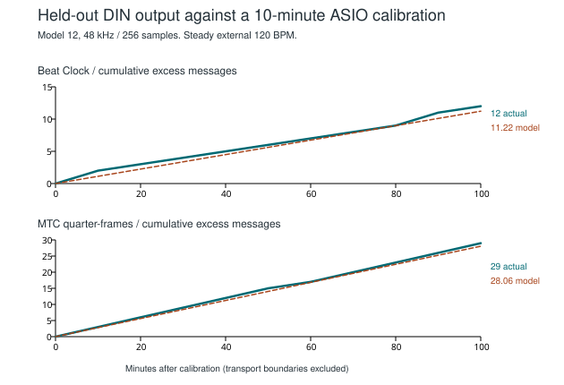

# H-10 外部時鐘、音訊裝置時鐘與起停邊界

Model 12 韌體 1.50 0103，48 kHz／256 取樣，UM-ONE 與兩段實體 DIN。全程靜音、獨立測試設定。兩輪兩小時均完成，實機執行檔為 `f13949d9`，各自的原始記錄保留在磁碟。

| 兩小時實機輸入 | 輸出 Clock／預期 | 輸出 quarter-frame／預期 | 掉鎖 |
|---|---:|---:|---:|
| 原工具邊送邊寫檔 | 345,607／345,600 | 864,023／864,000 | 7 |
| 獨立送碼、送完才寫檔 | 345,609／345,600 | 864,028／864,000 | 0 |

獨立送碼時第一段 DIN 最長間隔 22.188 ms，轉送後最長 22.224 ms，兩小時內均無 150 ms 空檔。EXT 單獨做五次斷碼重連，五次均依序回報 Waiting、Locked、Coasting、Locked、Stopped。主機觀測恢復時間 47.55～112.99 ms，包含查詢延遲。[實機收尾索引](overnight-evidence/夜間收尾.zh-TW.md)

## 穩定段的速差

同時使用 ASIO 原生取樣計數、Windows QPC 與實體 MIDI 收發時間。選相同的輸入 pulse 當每個十分鐘窗的首尾，窗內直接計輸出筆數。十一個完整且不含起停的窗合計 6,600 秒，裝置每個實秒平均走過約 48,001.87 取樣。以名義 48,000 換算，音訊時間多走了 257.666 ms。預期因此多 12.37 個 Clock、30.92 個 QF；實際分別多 13、31。

獨立交叉驗證只使用第一個十分鐘估得的 +38.966 ppm。用它預測後面 100 分鐘，Clock 與 QF 的原始筆數預測各差 0.78、0.94 筆；預測取樣時間差和實測相差 0.490 ms。這把長期偏差定位到輸出與音訊時基的關係。固定寫死這台裝置的 ppm 無法涵蓋其他裝置。USB MIDI 的個別到達抖動和起停計數另外量測。[十分鐘分窗](overnight-evidence/dedicated-source-two-hours/counter-domains.json) · [保留時窗預測](overnight-evidence/dedicated-source-two-hours/counter-holdout.json)

每十分鐘的 private bytes 中位數從 515,448,832 到 516,771,840，相差 1,323,008 bytes。中間有數個相鄰平臺，單次兩小時不足以判為洩漏或通過零成長門檻。觀測器佇列一度有 14 筆，首末窗中位數及 p99 均為 0。原生音訊連續兩個緩衝以上的回呼延誤計數為 0。[資源分窗](overnight-evidence/dedicated-source-two-hours/resource-windows.json)

## 起播及本機候選版

舊 callback 將七百二十八個取樣的音訊預填位置同時當成輸出起點。回歸測試預期外部定位 0、渲染位置 728，實際兩者都為 728。保留兩個座標後，#1669 整合分支 `44de4b91` 的播放套件 277 項通過、3 項略過。以 `f13949d9` 加單一修正所得實機程式 `17016e30` 重測三次 24 秒，均送出 Start；第一個 F8 在輸入 Start 後 20.91／25.99／22.26 ms。每輪皆是 1,153／1,152 Clock 和 2,882／2,880 QF。首兩個 Clock 只隔 1.54～1.86 ms，此版保留作比較。[舊版失敗](overnight-evidence/start-origin-before.log) · [整合套件](overnight-evidence/start-origin-after.log) · [三次實機](overnight-evidence/cue-v1-summary.json)

夜間原三個分支共用同一個 Cargo 輸出目錄，#1663 曾沿用 #1662 的測試執行檔，#1669 曾引用缺少 Clock API 的舊 mix 產物。重新以分支各自的編譯目錄驗證。#1669 在這次修正之前已獨立通過 276 項、略過 3 項。#1662 的產品選埠實機五針線計數為一般 64、DAW 0、一般 64。[#1669 原版本](overnight-evidence/follow-independent-check.log) · [選埠實機](overnight-evidence/product-physical-connectors.log)

## 第二版與回歸測試

獨立送碼長測的 ASIO 原始回呼共有 **1,351,067** 筆，所有 **1,351,066** 個間隔均落在 4～7 ms（最短 4.277、最長 6.766、平均 5.333、p99 6.076 ms）。取樣位置及序號都連續，這輪的累積速差在正常回呼節奏下發生。[回呼直方圖](overnight-evidence/dedicated-source-two-hours/asio-callback-histogram.json)

- **#1662 的起播間距。** 在一個 48 kHz、120 BPM、首次出現時已晚 728 個取樣的可重現案例，第一版最短 Clock 間距 5.7 ms。將第一個 F8 的遲到量分攤到第一拍，最短間距成為 20.2 ms，從起點到下一拍含邊界的 25 個 F8 都送出。
- **#1663 的 QF。** 同一例第一版會在相鄰兩次 100 µs 的輪詢中連送過期 QF。超過一個 QF 才見到起點時，先送當前位置，再接下一組完整 QF。案例中最短間距為 8.3 ms；第一個有效零延遲裝置時間戳的既有測試也通過。#1663 上一輪獨立播放套件已重新核對為 224 通過、3 略過。[間距紅測](overnight-evidence/cue-spacing-red.log) · [整合測試](overnight-evidence/cue-spacing-confirm.log) · [#1663 獨立驗證](overnight-evidence/standalone-mtc-verified.log)
- **#1669 的音樂網格。** 依播放中的音訊取樣和單調時間估算目前裝置速率，只將外部 BPM 及每個 F8 的時間投影到暫時的演奏網格。保留裝置取樣、錄音資料與來源 BPM。音訊回呼沒有新增估速或配置，主機每秒最多讀一次既有輸出狀態。兩小時的數值模擬以實際產生的 tempo map 查下一拍；+39 ppm 從最差 280.809 ms 降為 2.593 ms，−40 ppm 為 2.580 ms、理想時鐘為 0.000 ms。這組測試量的是網格拍點，並未擷取聲學起音。[修正前](overnight-evidence/device-grid-red.log) · [修正後](overnight-evidence/device-grid-green.log) · [情境測試](overnight-evidence/device-grid-all.log)

用舊兩小時錄音的真實 ASIO 時間戳再獨立驗證速率換算。每秒只讀取該時點已發生的一次回呼，預測半秒後的位置。用目標時間前後的回呼估計量測參考位置，總共 7,199 筆。名義 48 kHz 的絕對誤差 p99 **278.182 ms**、最大 **281.077 ms**；實際產品換算程式重播同一列資料時 p99 **0.734 ms**、最大 **1.092 ms**。這項證據檢查取樣座標換算，尚未涵蓋排程與實體輸出。[逐次擷取與原始量測](overnight-evidence/dedicated-source-two-hours/projection-observations.tsv) · [換算結果](overnight-evidence/projection-witness.log)

本機第二版分層 head 為 #1662 `bba12cc7`、#1663 `b6d756e9`、#1669 `de85a293`。最後一筆只修正測試的時間型別。ASIO 實機使用既有 G-11＋I24 驗收基底加上四筆相關修正的 `4cfaf099`。驗證依序執行各層套件、三次 24 秒啟停、完整兩小時。嚴格的 Clock 與 QF 總數繼續獨立判定。QF 描述音訊播放位置，單獨修正音樂網格的速率，無法證明 QF 也會符合外部牆鐘計數。[本機軟體狀態](overnight-evidence/morning-software-finished.json) · [第二版硬體進度](overnight-evidence/cue-v2-progress.json)
### 分層完測

各支在各自的建置目錄執行播放套件。#1662 通過 174 項、略過 1 項；#1663 通過 226 項、略過 3 項；#1669 通過 279 項、略過 3 項。#1669 的 Clock 情境另以 `--include-ignored` 執行，含 8 小時模擬、20 首連續混音、缺少裝置讀數及兩小時正負速差，**53 項全數通過**。[#1662](overnight-evidence/morning-final-beat.log) · [#1663](overnight-evidence/morning-final-mtc.log) · [#1669 播放](overnight-evidence/morning-final-follow.log) · [#1669 全情境](overnight-evidence/morning-final-grid-confirm.log)

## 第二版實體起停結果

同一個 120 BPM 來源、Model 12／UM‑ONE、48 kHz／256，每輪 24 秒。以下時間以輸入端收到 Start 為零點，每輪的環境檢查均有效。

| 輪次 | 實際起播控制 | 首 F8 | 最前八個 F8 間距中的最短值 | Clock 實收／預期 | QF 實收／預期 |
|---|---|---:|---:|---:|---:|
| 1 | SPP 1、Continue | 128.789 ms | 19.380 ms | 1,147／1,152 | 2,875／2,880 |
| 2 | Start | 19.381 ms | 19.470 ms | 1,153／1,152 | 2,874／2,880 |
| 3 | Start | 21.044 ms | 19.737 ms | 1,153／1,152 | 2,874／2,880 |

第一版三輪最前八個間距中，F8 最短 1.544～1.862 ms，QF 最短 0.615～0.642 ms。第二版對應區間是 19.380～19.737 ms、7.312～7.743 ms。排除兩端各一秒後，每輪 F8 相對理想間距的絕對誤差 p95，第一版 1.473～1.493 ms，第二版 1.456～1.484 ms。QF 同項第一版 0.867～0.894 ms，第二版 0.898～0.930 ms。第二版改善起始擠包，未證實穩速 QF 抖動改善。[逐輪分布](overnight-evidence/cue-comparison-six-trials.json) · [輸入輸出原始對照](overnight-evidence/cue-v2-summary.json)

第二版三輪的 Stop 經實體輸入轉送到虛擬輸入耗時 0.121～0.134 ms。虛擬輸入收到 Stop 到實體回線收到輸出 Stop 為 18.352～21.018 ms，其間每輪仍收到一個 F8 及二至三個 QF。輸出 Stop 之後三輪均無 F8 或 QF。這段量測含應用程式、輸出排程與返回線，無法只用兩端時間戳分攤各部分。[第一輪](overnight-evidence/cue-v2-1/stop-stages.json) · [第二輪](overnight-evidence/cue-v2-2/stop-stages.json) · [第三輪](overnight-evidence/cue-v2-3/stop-stages.json)

第一輪再次遇到晚到的首個播放區塊，輸出落到下一個十六分音符。已另備三種情境的測試及本機候選修正，區分「已在歌頭待命」、「播放中才接入」和「接入時已過一個十六分音符」。兩小時複測使用第二版。完成後才依序執行第三版的修正前測試、播放測試套件與三輪實體線路，避免編譯干擾時鐘。[兩小時狀態](overnight-evidence/cue-v2-progress.json) · [第三版驗證狀態](overnight-evidence/prearmed-v3-progress.json)

## 跟隨端查詢狀態的額外負擔

#1669 的主機端每次查詢 Clock 狀態時，即使沒有新 pulse、也沒有斷鐘，仍會重新計算音訊排程上限，並對音訊執行緒共享資料做六次 SeqCst 原子寫入或更新。已另建本機候選修正，只在查詢發現時脈真的過期時重新發布；MIDI 輸入端收到 pulse 仍照常更新。測試在穩定的兩個 pulse 之間連查 1,000 次，再讓時脈過期，分別檢查發布代數與 Coast 解除排程上限。這項測量的單位是共享狀態發布次數；尚未取得 CPU 時間或音訊延遲改善數據。候選修正未併入兩小時實機版本。[本機驗證狀態](overnight-evidence/publication-progress.json)

## 07:25 實機長測中斷

06:31:51 啟動，最後一筆狀態在 07:25:43；第一到最後一筆狀態相隔 3,223.327 秒。外部送碼程序在送 F8 時收到 WinMM sendMessage 錯誤，跟隨端記到一次失鎖並進入 Coasting，環境紀錄顯示 Windows 的預設播放端點也改變。應用程式累計最大回呼空檔 126.229 ms，六次超過兩個 buffer。缺少完整結束視窗，本輪未產生可驗收的兩小時 Clock／QF 總數。該次失敗不能據以認定為 STORAGE 後持續 251 ms 的同一問題。[送碼錯誤](overnight-evidence/cue-v2-two-hours.log) · [環境判定](overnight-evidence/cue-v2-two-hours/environment-result.json)

08:11 在本機再次列舉 WinMM。Model 12 的一般 MIDI 輸出列為 2、4，輸入列為 1、3。逐一指定編號開啟，兩個輸出及兩個輸入均回報 openPort 錯誤，未能開始第二次有效量測。

08:14 操作者補充，約 07:25 整理電線時曾見 Model 12 電源中斷，隨後自行恢復開機。這補足了當時的現場條件；該輪不適用於評估持續供電下的穩定性。08:14:46 再次雙向探測，Windows 仍列出兩組同名的一般 MIDI 埠，四次嘗試都在開啟 Model 12 埠時失敗，未送出測試 F8。[重新上電後探測](overnight-evidence/power-return-probe-081446.json)

## 電腦重新開機後的複測

Windows 於 08:19:45 啟動。08:23:32 一般 Model 12 MIDI 輸入與輸出各只列出一個；Model 12 → UM‑ONE 及 UM‑ONE → Model 12 各發 8 個 F8，兩邊皆收到 8 個。RDP 未連線，Chrome 遠端桌面最近事件為斷線，無編譯程序。08:23:42 從頭啟動第二版兩小時複測，實際開啟 Model Mixer ASIO 48,000 Hz／256，已鎖定約 120 BPM。上輪 53 分鐘保留為獨立的斷電紀錄。[雙向探測](overnight-evidence/reboot-probe-082332.json) · [本輪進度](overnight-evidence/reboot-0823-progress.json)

## 兩小時重測完成後的獨立解碼

08:23:42 至 10:24:24 的實機作業已跑完並完成分析，採集環境有效。兩小時內輸入 Clock 345,600、輸出 345,601、失鎖 0；MTC QF 共 864,024。ASIO 回呼平均 5.333 ms，最長 28.584 ms，取樣計數與回呼序號連續。主機觀察到的跟隨相位誤差，頭尾約十分鐘中位數分別 −0.917、−1.458 ms。原先以外部 7,200 秒為基準的嚴格計數仍未通過。[原始結果](overnight-evidence/reboot-0823-two-hours/複測摘要.zh-TW.md)

直接解碼每八個 DIN QF 的時、分、秒、格與速率位元，再用第一片的抵達時間對照同一台電腦量到的 ASIO 取樣位置。108,003 組由第 2 格連續走到第 216,006 格，每組恰好前進 2 格，零重複、零跳組。開始及停止的 full-frame 為 00:00:00:00 和 02:00:00:07。首個 QF 比輸入 Start 晚 68.307 ms；產生器先送 full-frame，再從完整的一組開始。以第一組為基準，最後一組的相對誤差，對電腦單調時間為 +245.112 ms，對裝置取樣僅 −0.352 ms。裝置基準的絕對誤差 p95 為 0.670、p99 為 0.822 ms。中段 110 分鐘實際取樣數推算 +26.663 QF，實收 +27。這支持 QF 地址跟隨音訊位置。它不能證明外接接收器的聲音同步精度，也無法讓原先外部計時計數測試通過。[解碼與逐分鐘速率](overnight-evidence/reboot-0823-two-hours/decoded-mtc-vs-device.json)

這輪第 7、8 個完整分鐘的裝置相對速率為 −324.7、−263.4 ppm，其後末段各分鐘多在 +34 至 +46 ppm 附近。只拿首十分鐘估速再外推整輪會失準。實測還有 7 組收到 QF 的相對時間與裝置位置差超過 5 ms，最大 18.566 ms，在 891.359 秒。同一時間前後 150 ms 內，送碼端最長 F8 間距 21.196 ms、實體輸入觀察點 33.038、虛擬輸入觀察點 51.750、實體返回 55.617；這個窗口沒有超過兩個 buffer 的 ASIO 回呼。量到的是各段接收時間，尚無法將偏差歸到單一執行緒或特定驅動。[峰值前後各段](overnight-evidence/reboot-0823-two-hours/mtc-outlier-stages.json)

本輪終點，輸入端的 Stop 到輸出端返回 Stop 為 16.767 ms；最後一個輸出 F8 在兩者之間，落在輸入 Stop 後 2.410 ms。退出端 Stop 後沒有再收到 F8 或 QF。[停止分段](overnight-evidence/reboot-0823-two-hours/stop-stages.json)

## 本機候選修正的軟體複驗

- #1662 在已見過歌頭停止狀態時保留 Start；播放中才接入的輸出沿用定位規則。第一次擴大起播範圍使兩項既有的取樣捨入邊界測試失敗，已限縮到已待命的情況。完整整合層播放套件 280 通過、3 略過，含兩項原有檢查。[修正前](overnight-evidence/prearmed-v3-red.log) · [中間候選版兩項失敗](overnight-evidence/prearmed-v3-green.log) · [修正後](overnight-evidence/prearmed-rounded-final.log)
- #1669 在兩個 pulse 之間查詢 1,000 次。在修正前，發布代數從 68 變為 2,068，即 1,000 次重複發布。修正後同一測試確認代數保持不動、發生 Coast 時立即更新一次、再查一次保持不動。播放套件 280 通過、3 略過。這裡測到共享狀態發布次數，未將它換算為音訊延遲。[修正前](overnight-evidence/host-poll-red-identified.log) · [修正後](overnight-evidence/host-poll-green-identified.log)

將長測的 QF 依編碼時間逐個編號，兩小時的名義範圍是第 0～863,999 片。這次 full-frame 定位後，第一組從第 8 片開始，共少了開頭 8 片；第 864,000 片起又收到 32 片，其中 30 片在輸入 Stop 前、2 片在輸入 Stop 後。全程差額因此恰好是 32 − 8 = 24。另在 #1663 本機分支加入只用模擬時間的獨立測試：同樣 600 秒，裝置時鐘 −40／0／+40 ppm 時，各應輸出 71,998／72,000／72,003 片，每片的裝置時間戳都應落在相隔 400 個取樣的位置。此層播放套件 227 通過、3 略過。[獨立測試紀錄](overnight-evidence/mtc-rate-playback-verified.log)

891.359 秒附近的每秒狀態也顯示，SoundCraft 內部累計最大發送遲到從 4.666 升到 16.519 ms。該秒的累計最大音訊回呼間隔從 6.212 變為 7.781 ms，Clock catch-up 計數未增加。可觀察到送出端也晚了；缺少同一事件的排程執行緒證據，還不能區分是 OS 排程延遲或程式工作量。[狀態快照差分](overnight-evidence/reboot-0823-two-hours/outlier-status-windows.json)

### 七輪重新起停與 Stop 相位

48 kHz／256、120 BPM，ASIO 版 6849b48f。三輪 24 秒都送 Start，首個 Clock 落在 17.101、20.732、19.473 ms；另四輪 12 秒將 Stop 分別提前 15、0、10、5 ms，均送 Start。七輪嚴格 Clock 總數都多 1，沒有任何一輪在返回 Stop 後繼續送 F8。四輪的最後 F8 相對輸入 Stop 為 +17.170、−0.722、+14.802、+7.704 ms（正值為在輸入 Stop 後收到）。其中一輪的 F8 提早抵達，僅加快收到 Stop 之後的處理無法召回已送出的訊息。這些時間分別來自虛擬埠及返回實體埠的擷取；程式內的交付時間另用專門量測版追查。[七輪原始數據](overnight-evidence/rounded-phase-trials.json)

另以兩小時的真實時間戳推算：若每個輸出 F8 都必須等到相同序號的輸入 F8，總數可對到 345,600，但有 365 個原已可送出的 F8 要延後，最差增加 45.262 ms，出現在同一段約 891 秒的擠包中。此為零起點、無斷鐘、單一零手動偏移輸出的離線反事實比較；未啟用這種輸出規則。[八輪策略比較](overnight-evidence/stop-count-bound-replay.json)

本輪候選程式均留在獨立的本機工作樹。#1662 單層 c7e2d50f 的播放套件 175 通過、1 略過；含起播與查詢兩項修正的 #1669 整合層 89f23837 為 281 通過、3 略過。[#1662](overnight-evidence/morning-rounded-beat-only-verified.log) · [#1669](overnight-evidence/morning-combined-rounded-verified.log)

### 首尾時間與主機負擔的對照

另以本機量測版 f60b1632 在四輪 12 秒中記錄程式自己的單調時間。在單一選取的輸入埠辨認 FC 後，呼叫 Player::stop 用了 0.12～0.16 ms，音訊回呼實際收到 Stop 用了 0.75～4.26 ms。由回呼收到 Stop 到 Windows MIDI 輸出呼叫送出 FC 又經過 15.240～15.494 ms。ASIO 回報的輸出提前量為 728 個取樣，即 15.167 ms；下方另外以 Beat Clock 輸出補償開關核對。四輪中三輪多一個 F8，交給 Windows 的時間在輸入程式辨認 FC 後 3.39～4.81 ms。提前 15 ms 發 Stop 的另一輪計數正確，最後一個 F8 在辨認 FC 前 2.86 ms 就已交付。程式內耗時及實體往返各使用自己的單調時基，沒有依賴跨程序的時鐘原點。[四輪分段](overnight-evidence/stop-witness-comparison.json)

主機查詢的微基準使用相同原始碼、鎖定同一個邏輯 CPU，先暖機 50 萬次再量 50 萬次。兩版以 ABBA 次序重複四次，每版共八個測量批次。在跟隨已鎖定且無新事件時，每次查詢的批次中位數由 75.130 ns 降為 34.635 ns，降低 53.9%。這是單一函式的成本；整台工作站的 CPU 使用率及音訊延遲沒有由此推算。[獨立微基準](overnight-evidence/host-poll-abba.json)

### 用補償開關驗證 Stop 的延遲來源

私人設定的工作站實例，Model 12／UM‑ONE 48 kHz、256 取樣、120 BPM，Stop 排在原本下一個 pulse 的時刻。API 逐次讀回設定，只有 Beat Clock 補償改動，MTC 補償保持開啟。四輪各 12 秒，環境有效。負值表示在程式辨認輸入 Stop 前已將最後一個 F8 交給 Windows。

| 測次 | Beat Clock 補償 | 音訊回呼收到停止至交付輸出 Stop | 交付最後 F8 相對於辨認輸入 Stop | 輸出／輸入 F8 |
|---:|---|---:|---:|---:|
| 1 | 開 | 15.564 ms | −0.219 ms | 577／576 |
| 2 | 關 | 1.203 ms | −15.273 ms | 577／576 |
| 3 | 關 | 0.958 ms | −9.489 ms | 577／576 |
| 4 | 開 | 15.492 ms | +4.927 ms | 577／576 |

補償解釋了大部分停止指令的交付等待。關閉後，走帶 Stop 和播放中的 F8 都提早到達輸出；四輪計數仍各多 1。即使維持預設補償開啟，也實測到過最後一個 F8 已在輸入 Stop 前完成原生送碼（第一輪早 0.081 ms 返回）。因此，只在收到 Stop 後清除佇列無法使所有輪次達到逐個 tick 守恆。此結果指向 #1669 外部跟隨與 #1662 依音訊播放位置產生 Clock 之間的計時規則；沒有證據指向 #1663 的 MTC 地址錯誤。保留原嚴格 H-10 判定「未通過」。此次未更改工作站的持久補償設定。[ABBA 完整量測](overnight-evidence/stop-compensation-abba.json)

## 外部 Stop 時最後一個 Beat Clock 的原生交付

逐次以輸入、輸出各自的 Start 為第 0 號脈衝，按實際 MIDI 訊息推進序號。八輪舊資料各有 576 個來源 F8，末號均為 575。七輪送出第 576 號；當中四輪在收到 FC 後才呼叫原生輸出，晚 3.387～4.927 ms，另三輪已在 FC 前 0.081～15.154 ms 完成原生呼叫。其餘一輪恰好送齊。序號描述接收端從 Start 累計的位置，未假設每一個 F8 都有可讀取的來源識別碼。[逐輪解碼](overnight-evidence/stop-ordinal-replay.json)

本機 #1669 候選在已辨認外部 Stop 時保存該次外部播放的最後有效序號。原生輸出執行緒在交付前核對該埠的 Start、SPP、Continue 所對應的位置。僅在同一播放段、零手動輸出偏移時攔下超界脈衝。明確 Stop 前照既有時間排程。斷鐘 Coast 不以先前收到的脈衝數封頂。已交給 Windows 的訊息無法撤回。

本機回歸測試中，舊邏輯在零起點與非零 Continue 都交付 3 個 F8，預期為 2。新測試另以真正的播放回呼建立播放段，將原生埠停在第一個 F8 的送出呼叫內，再從輸入埠送 Stop，確認同一批次的第二個有效 F8 隨後送一次，第三個被攔下。整套播放測試 285 通過、3 略過。產品候選 f533e1db，含額外回歸測試的本機 head 為 1af5815b。實機版 4ed607bf 含 I24 與時間戳探針。[舊版失敗](overnight-evidence/stop-ordinal-red.log) · [本機測試](overnight-evidence/stop-ordinal-batch-green.log)

Model 12 韌體 1.50 0103、UM‑ONE、48 kHz／256 取樣、120 BPM。每輪送 576 個 F8，Stop 提前量以原本下一個 F8 的排定時間為零。補償設定逐次由 API 讀回。末 F8 的交付時間以程式辨認輸入 FC 為零，負值表示在 FC 前已呼叫原生輸出。

| Beat Clock 補償 | Stop 提前 | 輸入／輸出 F8 | 本輪攔下 | 最後 F8 交付 | 穩態 F8 間距中位數 |
|---|---:|---:|---:|---:|---:|
| 開 | 0 ms | 576／576 | 1 | -15.976 ms | 20.853 ms |
| 開 | 5 ms | 576／576 | 1 | -16.509 ms | 20.862 ms |
| 開 | 10 ms | 576／576 | 1 | -10.012 ms | 20.867 ms |
| 開 | 15 ms | 576／576 | 0 | -3.696 ms | 20.855 ms |
| 關 | 15 ms | 576／576 | 1 | -17.318 ms | 20.869 ms |
| 關 | 10 ms | 576／577 | 0 | -4.832 ms | 20.861 ms |
| 關 | 5 ms | 576／577 | 0 | -9.594 ms | 20.865 ms |
| 關 | 0 ms | 576／577 | 0 | -14.970 ms | 20.860 ms |

八輪中 5 輪輸入、輸出數相符，總數短少 0 個，多出 3 個。多出的脈衝中有 3 個在程式辨認輸入 FC 前已完成原生送出。輸出埠自身的 FC 後收到 0 個 F8。以上為實體收發計數；只有攔截探針有記錄的輪次能直接歸功於候選。短測不取代原始兩小時 H-10。[逐輪原始索引與交付時間](overnight-evidence/stop-ordinal-matrix-4ed607bf.json)

### 候選版兩小時複測

2026-11-23 12:23（台灣時間）開始採集。使用上述本機實機版及兩段實體 DIN，中間經獨立量測的 Windows 軟體轉送。Beat Clock 與 MTC 輸出補償開啟，手動輸出偏移為 0。應收到 345,600 個外部 F8；分別核對實體輸入、軟體轉送及實體輸出計數、尾端原生交付順序、失鎖次數與 ASIO 回呼。原嚴格 H-10 的 MTC 計數條件另列。[執行環境](overnight-evidence/stop-ordinal-4ed607bf-two-hours/environment-start.json)

本輪於 2026-11-23T14:23:51+08:00 完成分析。環境檢查通過。來源／實體輸入／轉送後輸入依序為 345,600／345,600／345,600。實體輸出 F8 為 345,600，與輸入相差 +0；前次為 345,601／345,600。失鎖 0 次，輸出 FC 後另收 0 個 F8。

最後一次 F8 送出呼叫的起迄相對輸入 FC 為 -18.187、-18.067 ms。探針記錄了 1 次超界攔截。

ASIO 平均 5.333 ms，p99 6.081 ms，最大 21.323 ms；200–300 ms 區間 0 次。取樣位置及回呼序號不連續各 0／0 次。

原嚴格 H-10 驗收未通過。實收 MTC quarter-frame 864,023，外部計時原門檻 864,000；片段編號不連續 0 次。此數分開列出。 [本輪原始量測摘要](overnight-evidence/stop-ordinal-4ed607bf-two-hours/stop-verdict.json) · [回呼分布](overnight-evidence/stop-ordinal-4ed607bf-two-hours/asio-callback-histogram.json) · [嚴格計數測試](overnight-evidence/stop-ordinal-4ed607bf-two-hours-strict.log)

獨立解碼得到 108,002 組完整 MTC 地址，每組都前進兩格。末組在輸出 Stop 前送出第 0 至第 6 片，停止後補上一個完整定位。故實體總數為 108,002 × 8 + 7 = 864,023。完整組解碼不將最後七片當成完整地址。[完整組與停止邊界](overnight-evidence/stop-ordinal-4ed607bf-two-hours/qf-complete-and-partial.json)
